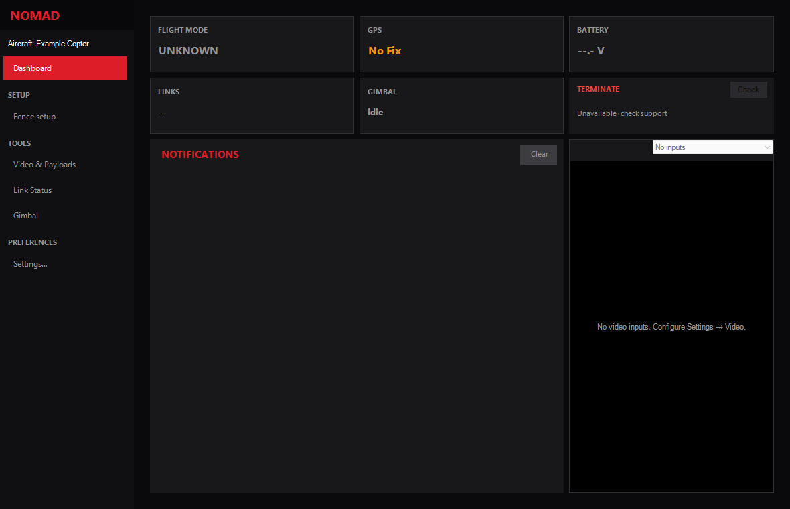
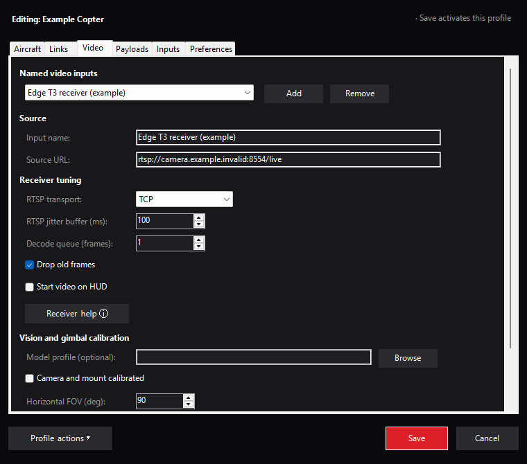
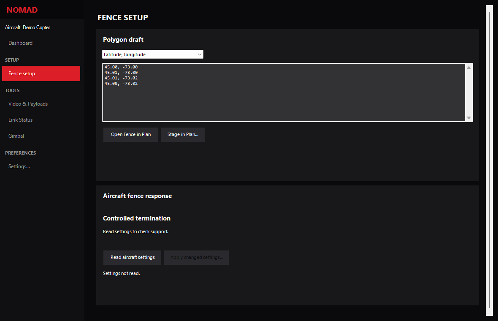

# NOMAD for Mission Planner

Aircraft profiles, video, custom controls and redundant telemetry links in one
Mission Planner plugin. Mission Planner owns the aircraft connection, normal
flight controls, setup and missions. ArduPilot owns flight execution and failsafes.



*Actual NOMAD controls rendered from the built plugin with an example profile.
No aircraft is connected; telemetry and actuator state are unverified.*

## Capabilities

| Feature | What it provides |
|---|---|
| Aircraft profiles | Separate video, links, payload calibration and input mappings for each aircraft |
| Video inputs | Named RTSP or RTP/H.264 UDP sources, input selection and receiver latency/queue settings |
| Gimbal and payloads | Native Mission Planner commands, calibrated outputs, bounded actions and input-loss Safe |
| USB HID inputs | Gimbal axes, payload controls and configurable switch/button mappings |
| Native fence setup | Coordinate validation and polygon staging in Mission Planner's existing Fence editor |
| Link router | Plugin-owned UDP/TCP/serial links, duplicate suppression, failover and link status |
| Optional aircraft firmware | A separate onboard TERMINATE mode for Copter and the supported QuadPlane layout |

The plugin is a single **.NET Framework 4.8 DLL** for Windows. The reviewed host
version is **Mission Planner 1.3.83**; [target metadata](scripts/release/mission-planner-target.json)
is the build authority. Video uses Mission Planner's installed GStreamer support.
Stock ArduPilot can use the base plugin. The termination action requires the
matching [custom firmware and aircraft setup](docs/native-termination.md).

## Get started

Download the DLL or ZIP from the [NOMAD 0.3.0 release](https://github.com/McGill-Aerial-Design/NOMAD/releases/tag/v0.3.0),
then follow the manual installation procedure below. The build steps are for source builds.

1. Install the reviewed Mission Planner host. To build from source, install Visual
   Studio's .NET desktop build tools and .NET Framework 4.8 targeting pack, plus
   [Pixi](https://pixi.sh/) for repository checks.
2. Build the plugin from the repository root:

   ```powershell
   pixi run build-plugin-only
   ```

   Output: `mission_planner/src/bin/Release/NOMADPlugin.dll`. Building never installs it.
3. Close Mission Planner, back up the installed DLL and operator profiles, then
   follow the [manual installation procedure](docs/operations.md#manual-plugin-installation).
   Copy only the reviewed plugin DLL; do not redistribute host reference assemblies.
4. Open **NOMAD → Settings**, create or select the intended aircraft profile, and
   review its mappings. **Save** activates that profile. Connect through native
   Mission Planner and verify the live aircraft before enabling custom controls.

For configuration storage, imports, calibration, Safe/Stop and native command
outcomes, use the [operator guide](docs/operations.md).

## Named video inputs

In **Settings → Video**, add an input, name it, enter its source URL, and choose
the input for that aircraft. RTSP supports TCP/UDP transport and jitter buffering;
the decode queue and old-frame dropping bound receiver buffering. Bitrate,
resolution and encoded quality are configured at the camera or encoder.



*Example receiver profile. The `.invalid` address is documentation data; no camera
was opened. An Ethernet receiver or a reachable Jetson/MediaMTX server can supply
the actual RTSP URL. Network access and encoder configuration remain external.*

## Native fence setup

Open **NOMAD → Open NOMAD → Fence setup** to load the published AEAC polygon or
paste GPS points. Review the coordinate order and stage the complete polygon in
native Plan with **Fence** selected. Staging changes the editor draft only; use
Mission Planner's native **Write**, then **Read**, to transfer and verify it.



*Public AEAC C1 coordinates in an unsent draft. This capture does not establish an
aircraft fence, approved altitude datum or termination configuration.*

## Firmware and releases

The optional [ArduPilot source carrier](firmware/ardupilot/README.md) targets
**CubeOrangePlus, APJ board ID 1063**, with separate Copter and Plane images.
It implements native termination without Lua and leaves ordinary LAND/QLAND
settings unchanged. CubeOrange is a different build target. Follow the
[firmware guide](docs/native-termination.md) for source pins, behavior, build commands,
commissioning requirements and evidence limits.

The [4.7.2-nomad.1 firmware release](https://github.com/McGill-Aerial-Design/NOMAD/releases/tag/ardupilot-4.7.2-nomad.1)
contains both board-specific images and their matching complete corresponding source.

| GitHub automation | Current result |
|---|---|
| [Windows plugin workflow](.github/workflows/csharp.yml) | Builds/tests the DLL and uploads an Actions artifact |
| [Documentation/Python workflow](.github/workflows/lint.yml) | Checks Python and builds documentation |
| [Pages workflow](.github/workflows/static.yml) | Publishes the documentation site |
| [Firmware qualification](.github/workflows/firmware.yml) | Runs native checks, packages both CubeOrangePlus images and matching source; manual runs can create a draft prerelease |

The plugin's `v*` tag trigger does **not** publish a GitHub Release. The firmware
workflow runs for relevant pull requests or manually. Without a release tag it
produces Actions artifacts; a supplied existing tag at the selected commit permits
a **draft prerelease** after qualification. Publishing that draft is separate.
Each package pairs the board-specific images with checksums, source/build identity,
qualification results and matching complete corresponding source. See the
[release procedure](docs/native-termination.md#build-and-release-automation).

## Development and support

Start with [development and checks](docs/development.md). The
[architecture](docs/architecture.md) describes ownership and lifecycle;
[safety](docs/safety.md) and [qualification](docs/qualification.md) define evidence limits.
Competition requirements and unresolved organizer decisions are recorded in the
[PRD](docs/prd.md) and [CONOPS source inventory](docs/conops-requirements.md).

For a reproducible bug report, include the NOMAD source/version, Mission Planner
version, vehicle/firmware type, expected behavior and the smallest reproduction.
Remove private URLs, credentials, identifiers and location data before sharing
profiles or logs. Screenshots can be regenerated with the
[command-driven capture procedure](docs/development.md#documentation-screenshots).

## Scope and licensing

Hardware calibration, transmitter termination mixing, physical flight behavior,
manual takeover and competition acceptance require aircraft-specific qualification.
Command ACKs do not prove actuator motion, touchdown or termination. Competition
server, perception and USB ground-controller termination integrations are outside
the current base implementation.

The plugin is [Apache-2.0 licensed](LICENSE). The separate ArduPilot firmware
changes are [GPL-3.0-or-later](firmware/ardupilot/COPYING.txt); see [NOTICE](NOTICE).
