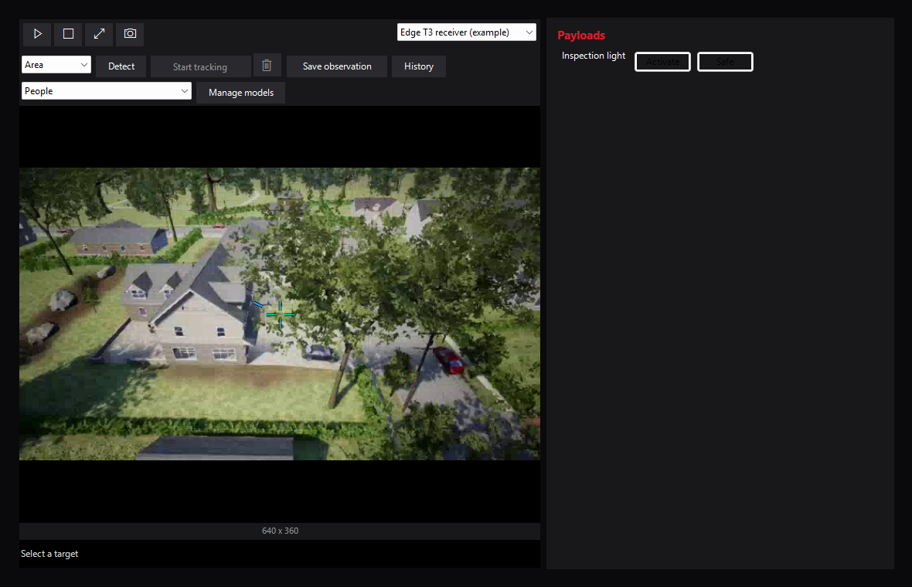

# NOMAD for Mission Planner

Aircraft profiles, video, custom controls and redundant telemetry links in one
Mission Planner plugin. Mission Planner owns the aircraft connection, ordinary
flight controls, setup and missions. ArduPilot owns flight execution and failsafes.


[Read the documentation](https://mcgill-aerial-design.github.io/NOMAD/) for setup,
operator workflows, system architecture and aircraft qualification limits.

## Capabilities

| System | What it provides |
|---|---|
| Aircraft profiles | Separate video, links, payload calibration and input mappings for each aircraft |
| Video | Named RTSP or RTP/H.264 UDP sources with receiver buffering settings |
| Detection and tracking | Local object detection, click/drag region tracking, calibrated gimbal following and saved observations |
| Gimbal and payloads | Native Mission Planner mount, servo and relay commands with calibrated limits and Safe/Stop |
| Input controls | Named HID controls, button/axis detection and payload/gimbal bindings |
| Native fence setup | Polygon staging in Mission Planner and supported fence/failsafe configuration |
| Link router | Plugin-owned UDP/TCP/serial links, duplicate suppression, failover and status |
| Optional aircraft firmware | A separate onboard TERMINATE mode for Copter and the supported QuadPlane layout |

NOMAD is a **.NET Framework 4.8 DLL** for Windows, targeting **Mission Planner 1.3.83**.
The [host target metadata](scripts/release/mission-planner-target.json) is the build authority.
Video uses Mission Planner's installed GStreamer support. Stock ArduPilot supports
base plugin use; termination requires matching custom firmware and aircraft commissioning.

## Get started

1. Download setup from [NOMAD releases](https://github.com/McGill-Aerial-Design/NOMAD/releases).
2. Close the intended Mission Planner installation, run setup and follow
   [installation and rollback](docs/operations.md#plugin-installation).
3. Open **NOMAD → Settings**, create or select an aircraft profile and review its
   calibration and mappings. **Save** activates that profile.
4. Connect through Mission Planner and verify the live aircraft before using custom controls.

See [operations](docs/operations.md) for profiles, links, fences and input controls,
and [video and tracking](docs/video.md) for cameras, detection, gimbal calibration,
observations and model profiles. Ordinary aircraft flight remains in Mission Planner.



## Build and contribute

Install the reviewed Mission Planner host, Visual Studio's .NET desktop build tools,
the .NET Framework 4.8 targeting pack and [Pixi](https://pixi.sh/), then run:

```powershell
pixi run build-plugin-only
```

Output: `mission_planner/src/bin/Release/NOMADPlugin.dll`. Building never installs it.
Use [development and checks](docs/development.md) before manual installation.
The [architecture](docs/architecture.md) describes ownership and lifecycle;
[ecosystem integration](docs/integrations.md) describes mounts and companion services.

The [Windows workflow](.github/workflows/csharp.yml) builds/tests the DLL and offline
setup. [Python/documentation checks](.github/workflows/lint.yml) validate tooling
and build the HTML site; [Pages](.github/workflows/static.yml) publishes it from main.
Plugin tag builds do not publish a GitHub Release.

## Firmware and qualification

The optional [ArduPilot source carrier](firmware/ardupilot/README.md) targets
**CubeOrangePlus, APJ board ID 1063**, with separate Copter and Plane images.
It provides native termination without Lua and leaves ordinary LAND/QLAND rates unchanged.
CubeOrange is a different target. The [native termination guide](docs/native-termination.md)
covers commissioning, radio input, guarded ground operation, source pins and releases.
The [firmware workflow](.github/workflows/firmware.yml) qualifies images and matching
source packages; publication of a draft prerelease is a separate step.

Hardware calibration, physical radio mixing, manual takeover, actual descent and
competition acceptance require aircraft-specific qualification. Command ACKs do not
prove actuator motion, touchdown or termination. See [safety](docs/safety.md),
[qualification](docs/qualification.md), [requirements](docs/prd.md) and
[CONOPS traceability](docs/conops-requirements.md).

## Licensing

The plugin is [Apache-2.0 licensed](LICENSE). The separate ArduPilot firmware
changes are [GPL-3.0-or-later](firmware/ardupilot/COPYING.txt); see [NOTICE](NOTICE).
