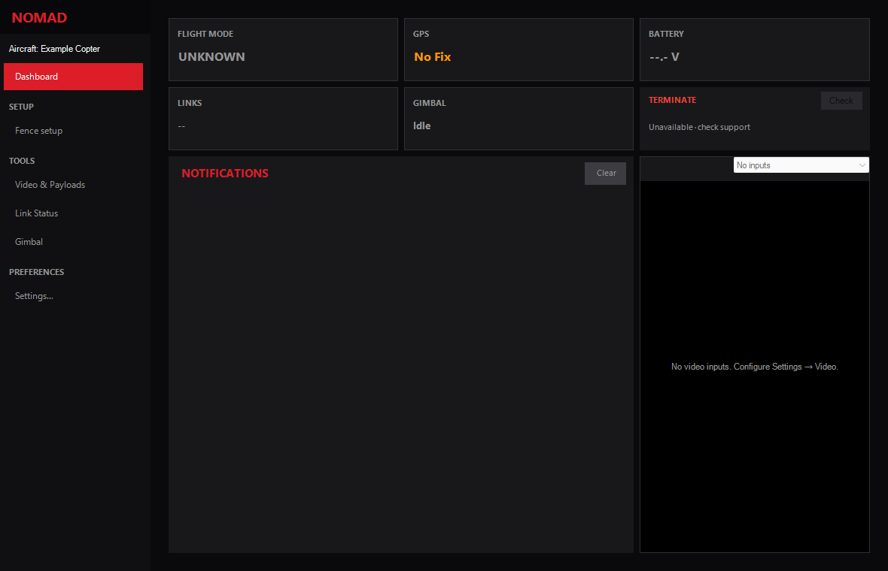

# NOMAD for Mission Planner

A Windows Mission Planner plugin for aircraft profiles, video, gimbal and payload
controls, HID inputs, native fence setup and redundant telemetry links.
Mission Planner owns the aircraft connection, normal flight controls and missions;
ArduPilot owns flight execution and failsafes.



**Start here:** [operator guide](docs/operations.md), [video and tracking](docs/video.md),
or the [documentation site](https://mcgill-aerial-design.github.io/NOMAD/).

## Install

NOMAD is a .NET Framework 4.8 DLL targeting **Mission Planner 1.3.83**.
[Target metadata](scripts/release/mission-planner-target.json) is the build authority.
Video uses the host's installed GStreamer support.

Download the matching setup from [releases](https://github.com/McGill-Aerial-Design/NOMAD/releases),
close Mission Planner and follow [installation and rollback](docs/operations.md#plugin-installation).
In **NOMAD -> Settings**, select an aircraft, review its mappings and calibration,
then Save. Connect through Mission Planner and verify the live aircraft.

## Contribute

Read [CONTRIBUTING.md](CONTRIBUTING.md) and [AGENTS.md](AGENTS.md).
The [architecture guide](docs/architecture.md) shows where code belongs, how to
read telemetry and how to send commands through the existing Mission Planner path.
[Development](docs/development.md) covers prerequisites and checks.

```powershell
pixi run build-plugin-only
```

Output: `mission_planner/src/bin/Release/NOMADPlugin.dll`. Building never installs it.
The [Windows workflow](.github/workflows/csharp.yml) builds/tests the DLL and offline setup;
[lint](.github/workflows/lint.yml) checks Python/docs, and [Pages](.github/workflows/static.yml)
publishes the site. Plugin tag builds upload artifacts without creating a GitHub Release.

## Competition and aircraft acceptance

[Product scope and task workflows](docs/prd.md) separate current capabilities from
[CONOPS requirements](docs/conops-requirements.md).
[Brainstorming](docs/brainstorming.md) holds proposed AEAC approaches and research.
[Safety and qualification](docs/safety.md) defines the limits of software evidence.

The optional [ArduPilot extension](firmware/ardupilot/README.md) adds a separate
onboard TERMINATE mode for Copter and the supported QuadPlane layout on
**CubeOrangePlus, board ID 1063**. It requires matching firmware and
[aircraft commissioning](docs/native-termination.md); stock firmware supports ordinary plugin use.
An ACK does not prove actuator motion, descent, touchdown or physical safety.

## Licensing

The plugin is [Apache-2.0 licensed](LICENSE). The separate ArduPilot changes are
[GPL-3.0-or-later](firmware/ardupilot/COPYING.txt); see [NOTICE](NOTICE).
