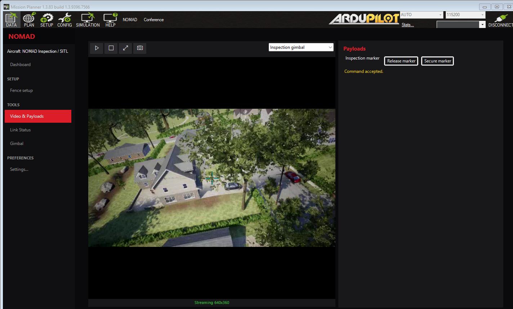
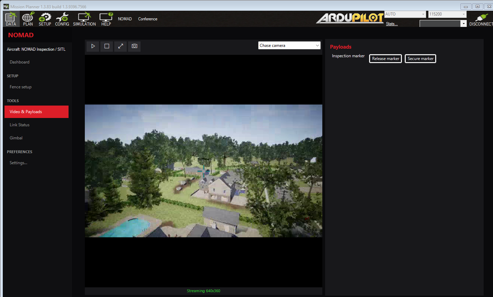

# Neighborhood inspection with NOMAD

Fly a short ArduPilot mission over a rendered neighborhood, inspect a roof through
NOMAD's gimbal camera, and command a marker output after the audience cuts a
telemetry route. This runs the actual Mission Planner host, NOMAD plugin, ArduPilot
SITL and Project AirSim Neighborhood environment. The camera shows the current
rendered scene; its pose follows observed controller servo outputs. Compare an
ordinary landing with the custom firmware's native, latched TERMINATE descent.

Mission Planner owns flight controls and missions. ArduPilot executes the flight.
NOMAD supplies its normal video, gimbal, payload and link-router controls, and
discovers and requests the firmware's separate TERMINATE mode. No Lua is used.



## Prepare the laptop

Run commands from the repository root. Required:

- Windows x64 with Mission Planner **1.3.83** in its standard installation folder.
- Visual Studio/MSBuild, Roslyn and the .NET Framework 4.8 targeting pack described
  in the [development guide](../docs/development.md).
- Python **3.11**, available through `py -3.11`.
- GStreamer x64 at `C:\gstreamer\1.0\msvc_x86_64`, including `x264enc`,
  `rawvideoparse`, `tcpclientsrc` and `rtspclientsink`; Mission Planner's own
  installed GStreamer runtime is also required.
- The custom Windows **ArduCopter 4.7.2 native-termination** runtime directory,
  containing `ArduCopter.exe`, its `cyg*.dll` dependencies, `copter.parm`,
  `manifest.json` and corresponding-source notices. A stock or rolling SITL
  download is not interchangeable.

The source identity is fixed:

| Item | Required identity |
|---|---|
| ArduPilot | 4.7.2, `fb773567896014da007bca58358704d4a0d8516f` |
| Native termination patch SHA-256 | `4beb471e4b1fc769d6285c09c44fbd1618fab81caac0b13ca4c69a3a121d2be8` |
| Complete corresponding source SHA-256 | `f728fb7fc24260b3f85445e2a3f8ed2786ec642c256374a41db703fbb8b374ab` |
| Required features | Advanced failsafe and Copter advanced failsafe enabled; scripting disabled |
| Windows executable SHA-256 | `cfc531fc56dd7cce1d69cb328803c642aedce9b24cdae7148fe7f46869444bf4` |
| Runtime manifest SHA-256 | `d7214b1626038936c56a773a0c6f031fe7a36adcc0353534c0f0d535e6d4944f` |

The [Conference Windows SITL workflow](../.github/workflows/conference-sitl.yml)
builds this Copter runtime with Cygwin on the conference branch. It has read-only
repository permissions and retains the small `conference-windows-sitl` runtime
artifact for **one day**. Download the artifact while it is available; preserve its
manifest, DLLs, `SOURCE.txt` and GPL notices together. The artifact is a simulator
build, not flight qualification or a controller firmware image.

`SOURCE.txt` links the existing
[complete corresponding source release](https://github.com/McGill-Aerial-Design/NOMAD/releases/download/ardupilot-4.7.2-nomad.1/complete-corresponding-source.tar.gz)
and its fixed checksum. The archive already contains the applied patch and pinned
submodules. The workflow does not upload another copy of that source archive.
For local reproduction, use Cygwin Python 3.12 and the prerequisites in the workflow:

```sh
python3.12 conference/build_sitl.py --work /tmp/nomad-conference-sitl-new
```

The work path must not exist. Keep the resulting runtime's recorded compiler,
source and file hashes; an arbitrary executable with the same version label is
not the same cohort. Extract the downloaded runtime into a directory such as
`build/conference/sitl-4.7.2-terminate`, then prepare the laptop:

```powershell
powershell.exe -NoProfile -ExecutionPolicy Bypass -File .\conference\setup.ps1 `
    -SitlRuntimeDirectory 'C:\path\to\sitl-4.7.2-terminate'
```

Setup needs Internet access and space for a copied Mission Planner installation,
the simulator, Python environment and run evidence. It downloads the packaged
[Project AirSim 1.0.1 Neighborhood](https://github.com/iamaisim/ProjectAirSim/releases/tag/v1.0.1)
and [MediaMTX 1.21.2](https://github.com/bluenviron/mediamtx/releases/tag/v1.21.2),
verifies their archive hashes, and installs the pinned Python clients. Unreal
Editor, a source build of Unreal and paid services are not required. Retain the
downloaded components' licenses and notices.

The prepared host, plugin, simulator configuration and identity manifest live in
`build/conference/prepared`. Setup builds and copies the plugin into that host;
it does not install it into the operator's Mission Planner. Repeat setup after
changing the plugin or prepared files. Launch verifies the manifest hashes.

## Rehearse the complete check

Close other Mission Planner sessions first. Check calibration without starting
processes, then request the full local simulator rehearsal:

```powershell
.\build\conference\python\Scripts\python.exe .\conference\camera.py --check
powershell.exe -NoProfile -ExecutionPolicy Bypass -File .\conference\run.ps1 -Check
```

The full check makes **two flights in the same controller boot**:

1. Read back the commissioning parameters and observe healthy simulated RC input.
   Require the actual NOMAD controller to discover selectable TERMINATE while
   disarmed. Normally arm, take off to 25 m in GUIDED and request ordinary LAND
   above the clear launch site. Measure descent, observe landed state, normally
   disarm and observe disarmed state.
2. Normally arm again, take off to 25 m and enter AUTO for the uploaded survey leg.
   Require mission progress and changed GPS position. Switch between both actual
   camera inputs, observe gimbal outputs, cut the radio route, and operate the
   marker over the remaining route: explicit Safe, two confirmations, then Safe.
   Restore routes, return with RTL, and enter GUIDED hold above the clear launch
   area before RTL descends below the comparison height. Request TERMINATE through
   the actual NOMAD controller and observe fresh mode 29 plus the measured descent.

The comparison uses controller timestamps and signed downward velocity, cross-checked
against altitude loss over time in both the **12–18 m** and **1–5 m** height bands.
Each band needs at least three samples spanning half a second, coverage within
0.6 m of both band edges, and no sample gap over 500 ms. Both calculations use
MAVLink estimator data; they are not separate ground-truth measurements.

| Behavior | Configured target | Required observed evidence |
|---|---|---|
| Ordinary LAND | `LAND_SPD_MS=0.5`, `LAND_SPD_HIGH_MS=0.5` | Signed velocity and altitude/time rate within 0.2–1.0 m/s in both bands |
| Native TERMINATE | `AFS_TERM_RATE=2.2` | Fresh mode 29, with both rates within 2.0–2.7 m/s in both bands |
| Termination latch | Controller reboot required | Explicit rejection ACK for an ordinary mode request, fresh continuing mode 29, and normal rearming refusal after landing |

These are configured targets and acceptance ranges, not measured results. An ACK
alone proves neither the mode nor descent. The check requires separate fresh
heartbeat, position, landed and disarmed observations. Rejections require a new
matching DENIED or FAILED ACK; a timeout or unsupported command is not evidence
of the latch. It also reads back the unchanged ordinary LAND speed parameters.

Native TERMINATE owns contact disarming. After landing, the check attempts normal
rearming and requires explicit refusal with the native latch reason and continuing
disarmed TERMINATE state. It ends with reboot required. A preserved-parameter
controller-restart test is separate; MP reconnection alone does not establish reset.

After Mission Planner closes, the launcher deliberately stops one owned encoder
and requires the camera bridge to report failure and stop its sibling encoder.
That camera failure is expected only at the end of `-Check`. A successful run
requires both the native rehearsal and this lifecycle check to complete.

Each invocation creates `build/conference/run-<timestamp>-<id>`. Inspect
`result.json`, `lifecycle.json` and the command's exit status together. Require the
actual measured summaries and latch observations, not just a completed build. The final
`camera-status.json` records the deliberate encoder failure, not a failed flight
check. Screenshots and diagnostic logs remain in that run directory. These are
software integration results for the pinned simulator cohort, not aircraft qualification.

## Present the inspection



```powershell
powershell.exe -NoProfile -ExecutionPolicy Bypass -File .\conference\run.ps1
```

The launcher opens the neighborhood renderer and a separate Mission Planner host
with one conference aircraft profile. It connects through NOMAD's router, uploads
the short mission and opens NOMAD's Video & Payloads page with the inspection
stream playing. Wait for normal ArduPilot pre-arm readiness; startup `ready`
does not establish flight readiness.

| Person | Responsibility |
|---|---|
| Presenter | Explain the inspection and let the audience choose the camera aim and telemetry fault |
| Mission Planner operator | Review and fly the mission; use NOMAD gimbal, marker and Safe controls |
| Fault/evidence operator | Select the Conference menu fault, show Link Status and controller output telemetry |

1. In native **Plan**, use **Read** to review the uploaded mission. It contains a
   25 m takeoff, a short survey leg, a 90-second inspection loiter and RTL.
   Review the owned simulator's commissioning parameters before arming. The native
   fence and AFS/RC entry checks remain enabled; polygon staging is a separate
   optional demonstration through NOMAD Fence Setup and native MP Write/Read.
2. Show ordinary LAND first: use native MP controls to arm normally and take off
   in GUIDED to 25 m above the launch site, then request LAND. Observe its ordinary
   descent, landed state and normal disarming. Normally arm and take off again;
   enter AUTO for the uploaded mission. Show the actual HUD, position
   and mission progress as ArduPilot reaches the inspection area.
3. Open NOMAD's Gimbal control and use MAVLink targeting to aim at a roof. Select
   **Inspection gimbal** or **Chase camera** from the video input dropdown.
   The inspection camera follows actual SITL output: channel 7 is pitch and
   channel 8 is roll. Both feeds are live renders of this simulation.
4. Ask the audience which route to interrupt. The top-level **Conference** menu
   offers **Cut telemetry radio**, **Cut telemetry network**, **Cut both telemetry
   routes** and **Restore routes**. Each selects a complete route state; cutting
   one explicitly enables the other. Show NOMAD Link Status and repeat a gimbal
   movement through the surviving route.
5. In NOMAD's payload controls, select **Secure marker** first. Select
   **Release marker** twice to satisfy its confirmations. Observe controller
   channel 9 at 2000 PWM, then select **Secure marker** and observe 1000 PWM. This demonstrates
   the release output; no physical marker or delivery is modeled.
6. Restore routes and request native RTL toward the clear launch site. Before RTL
   descends below 20 m, enter GUIDED hold above that area. Do not terminate onto
   the roof inspection area.
7. Open **NOMAD → Dashboard** and select the TERMINATE widget's **Check**. With the
   NOMAD window in the foreground, hover over the widget, release both Shift keys,
   then press left and right Shift within 750 ms so both are down together. Keep
   focus and the pointer there, release both keys, and review the aircraft-named
   confirmation. Only explicit OK requests TERMINATE; Cancel sends no request.
8. Observe fresh TERMINATE mode and the actual descent through touchdown. Observe
   landed and disarmed state separately. The latched aircraft cannot resume normal
   flight or rearm until controller reboot. Normal LAND and TERMINATE have different
   disarming behavior: `DISARM_DELAY=0` requires manual disarm after ordinary LAND;
   native TERMINATE retains its own contact/disarm path.

Close the conference Mission Planner window to end the session. The launcher
requests camera/link shutdown and stops only its owned processes. It verifies
preservation of the installed plugin and the named operator configuration/profile
files; it does not claim every host cache or log is unchanged.

## Operating limits

- Once prepared, the run needs no Internet service. MP uses cached map tiles;
  check coverage before presenting. The rendered neighborhood does not depend
  on those tiles. Missing tiles do not change the controller's position telemetry.
- Use an offline or trusted network. The owned forwarding gates, RTSP server and
  camera encoder sockets use loopback, but the simulator components also expose
  wildcard listeners: SITL's sensor input includes `0.0.0.0:9003`, and Project
  AirSim's server can listen on `::`. The launcher does not change firewall rules.
- The telemetry paths are local byte-forwarding gates into one real controller.
  They exercise the actual NOMAD router, not RF range, LTE behavior or independent
  physical redundancy. Both-down operation follows the configured ArduPilot
  failsafes; rehearse it separately before selecting it during a flight.
- Camera transport and its controller-output observer are independent of those
  two telemetry gates. Video can continue while the operator's telemetry is lost.
  A moving image alone does not establish a healthy command path.
- Commissioning uses the pinned simulator's native 50 Hz receiver defaults, with
  CH7 valid LOW, low throttle and an ordinary mode-switch position. There is no
  receiver process, MAVLink RC override, forced arming or disabled arming check.
  The simulated receiver does not establish physical radio health or switch wiring.
- Stock SITL does not implement this custom TERMINATE mode. This Copter-only
  rehearsal does not qualify RC/HID hardware, QuadPlane behavior, real camera or
  payload calibration, fence containment, physical landing or termination.

For the plugin's normal controls and storage behavior, see
[operations](../docs/operations.md) and [native termination](../docs/native-termination.md).
The firmware's dedicated-input, RC-loss, fence and latch checks remain onboard;
the camera bridge does not implement flight policy. For the simulator interfaces and configuration,
see the [Project AirSim ArduPilot guide](https://github.com/iamaisim/ProjectAirSim/blob/v1.0.1/docs/controllers/ardupilot.md).
