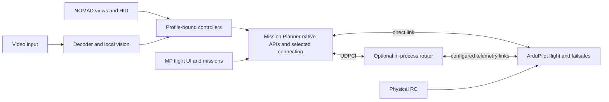

# Architecture and contributor guide

NOMAD runs inside Mission Planner as one C#/.NET Framework 4.8 DLL. The reviewed
host is pinned in [target metadata](https://github.com/McGill-Aerial-Design/NOMAD/blob/main/scripts/release/mission-planner-target.json).
Use its actual APIs and the existing owners below when extending the plugin.



Mission Planner owns the connection and MAVLink reader. ArduPilot executes flight
and native failsafes. The router's C# sources compile into the same DLL; the
optional firmware under `firmware/ardupilot/` builds separately and runs onboard.

## Find and reuse the owner

Paths below are under [mission_planner/src](https://github.com/McGill-Aerial-Design/NOMAD/tree/main/mission_planner/src)
unless shown otherwise.

| Area | Existing owner and responsibility |
|---|---|
| Plugin lifecycle | `Plugin/NOMADPlugin.cs` and partials: Init, Loaded, Loop, Exit, menus and shared owners |
| Aircraft configuration | `Config/NOMADProfiles.cs`, `NOMADConfig`, `NOMADStorage`: validated drafts, selected profile, atomic persistence and host data paths |
| Native dispatch | `Control/OutputController.cs` and `.Payload.cs`: connection identity, generations, write eligibility and native host helpers |
| Custom controls | `GimbalController`, `PayloadController`, `TerminationController`; `Input/` owns HID sampling and bindings |
| Fence setup | `Geofence/`: polygon validation, native editor drafts and `FenceParameters` read/write/readback |
| Telemetry and alerts | `Telemetry/BatteryHealth.cs`, `AltitudeUnits`, `Notifications/NotificationService` and `AudioAlerts` |
| Video | `Media/VideoSession` owns pipeline/worker/frames; `SharedVideoCapture` shares local cameras; `EmbeddedVideoPlayer` owns selection and presentation |
| Vision | `Vision/IVideoDetector`, `IVisualTracker`, `VisualTrackerFactory`: model and tracker boundaries |
| Links | `Connectivity/MAVLinkConnectionManager` projects the router in `infra/transport/ground_router/` through `IRouterStatusProvider` |
| Views | `Views/`, `Panels/`, `UI/ControlFactory`, `NOMADTheme`, `NOMADViewBase`, `UiAsync`; `IUpdatableView` is declared in `Plugin/NOMADMainScreen.cs` |
| Simulation | `Simulation/` owns the optional page/session; `scripts/simulation/` supplies development launchers |

Read the owning symbol, callers and closest tests before changing behavior.
Partial files divide one owner; they are not separate services or new extension points.

## Read aircraft telemetry

For display-only state, follow `NOMADDashboardView.UpdateFlightCards`:

```csharp
var mav = MainV2.comPort?.MAV;
var cs = mav?.cs;
if (cs?.connected == true)
{
    // Display cs.mode, cs.armed, cs.gpsstatus, etc.
}
```

Read the selected aircraft each update. A cached `MAVState` can belong to a prior
aircraft, and `cs.connected` does not establish packet freshness. Reuse
`BatteryHealth.Read(mav, index)` for native battery thresholds. `CurrentState.alt`
and `sonarrange` follow MP display units; use `AltitudeUnits.ToMeters` with the
host multiplier. Check the owning field's units before doing calculations.

Commands and motion estimates need stronger evidence. Follow
[VideoMotionHistory](https://github.com/McGill-Aerial-Design/NOMAD/blob/main/mission_planner/src/Media/VideoMotionHistory.cs):

1. Capture the selected target through `OutputController.CaptureTarget(config)`.
2. Read its `Connection.MAV.getPacketLast((uint)messageId)` packet cache.
3. Verify system/component, UTC receipt time, age, finite values and valid ranges.
4. Recheck `target.IsCurrent` before admitting a result or dispatching work.

A cache read returns the last packet, including old data. Define a freshness bound
appropriate to the action; do not turn missing telemetry into a healthy default.
Existing packet subscriptions must be removed by the subscribing owner. Never add
another `BaseStream` reader or a parallel MAVLink connection to obtain telemetry.

## Send commands through Mission Planner

UI and HID call the existing Gimbal/Payload/Fence/Termination controllers.
`OutputController` binds work to the connection, stream, selected system/component
and profile generation. Disconnects, selection/profile changes and read-only or
playback contexts retire unsent work.

When extending a controller, use the captured target and explicit-target host APIs
such as `doCommandAsync`, `setMountControl` and `setParamAsync`, following the
adjacent implementation. Mission Planner owns ACK waits and retries. Preserve
input neutral/confirmation rules, finite/range checks and Safe/Stop behavior.
An already-dispatched helper may finish after Stop or unload; report submitted,
accepted, unknown and independently observed outcomes truthfully.

The optional router gives MP one loopback UDPCl connection and sends each command
through one selected physical route. It owns deduplication, failover and parameter
transaction pinning. Reuse that owner instead of adding a transport. Normal
arming, modes, missions, setup and landing remain in Mission Planner.

## Profiles, UI and lifetime

`NOMADProfiles` owns draft/copy/import/export and explicit Save activation.
Loading validates the current schema without rewriting files; saving atomically
replaces the collection with a backup. Use `NOMADStorage` for host-resolved paths.
Aircraft labels describe configuration and do not establish live aircraft identity.

Reuse `ControlFactory` and `NOMADTheme`. Views refreshed by the main screen implement
`IUpdatableView`. Use `UiAsync` to observe event-handler errors and marshal synchronous
updates to an existing UI handle. Unsubscribe events and dispose timers, frames,
capture leases and cancellation sources with their owner. Fence cached callbacks
by the plugin session; hiding a view does not retire a shared owner.

Video keeps matching pixels, detections and tracker results in a frame envelope.
The decode worker alone initializes/updates/disposes vision. Model, selection and
source revisions discard late results. Local camera viewers lease one capture per
device; the last lease stops it. Network players own separate pipelines.
Default Object tracking uses CPU CSRT; explicit GPU Object tracking uses EfficientTAM
through DirectML. Area uses its own fixed-point tracker. GPU failure is reported.
All tracking reaches the same guarded gimbal path and requires explicit activation.

Fence staging modifies a native editor draft; native Write/Read transfers it.
Parameter changes separately require fresh disarmed state and readback. The optional
simulator starts only on request and owns its processes and private native handshake.
Plugin Exit retires inputs/callbacks and disposes shared resources. See
[safety](safety.md) and [development checks](development.md) before changing these contracts.
