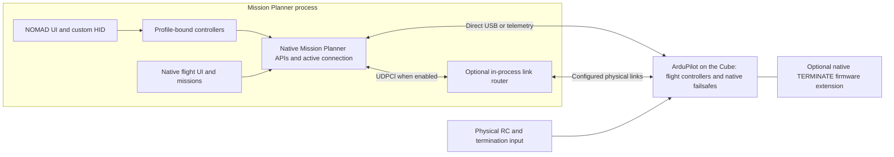

# Architecture

NOMAD runs inside Mission Planner as one C#/.NET Framework 4.8 plugin.
The reviewed host version is stored in `scripts/release/mission-planner-target.json`.

Mission Planner owns opening/closing the selected aircraft connection, its protocol
reader, ordinary flight UI, firmware setup and mission execution requests. ArduPilot
owns stabilization, navigation execution and native failsafes. NOMAD never starts
Mission Planner's HID RC override loop merely to read custom input devices.

`NOMADPlugin` owns the host lifecycle and registers the menus/screens. `Config/`,
`Control/`, `Input/`, `Media/` and `Views/` are logical source groups compiled into
that same DLL, not separately running services. The C# router sources under
`infra/transport/ground_router/` are also compiled into the plugin. `OutputController`
is the internal guard for dispatch through the current host target.
The separate GPL source carrier under `firmware/ardupilot/` builds aircraft firmware;
its flight policy runs on the Cube, independently of the ground plugin.

## Custom controls

`OutputController` captures the live host connection, stream, system/component IDs
and profile generation. Connection/selection/profile changes retire unsent input.
Closed, read-only and playback contexts cannot dispatch custom commands. A real
centered sample is required after analog input loss or generation changes; held
buttons/keyboard repeats cannot carry activation into another aircraft.

Gimbal uses the host's explicit-target mount APIs and displays submitted/unverified
outcomes. Payload definitions remain in profiles: servo toggle, position and
bidirectional motion, relay toggle and pulse. `PayloadController` owns only local
confirmation/neutral interlocks, input lifetime and software outcome presentation.
Mission Planner owns native ACK waits and retries. Already-dispatched helpers cannot
be cancelled by NOMAD; Safe/Stop waits for the pending helper before attempting Safe.
Native repeat commands bound timed outputs on the controller and have a shared slot.
See [safety](safety.md) for trim checks, uncertain outcomes and unload limitations.

## Links and lifetime

The optional `MAVLinkConnectionManager` owns the existing C# router engine and its
physical UDP/TCP/COM links. It exposes exactly one bidirectional loopback consumer:
Mission Planner, connected using UDPCl. The router forwards each command to one selected link, retains
parameter-transaction pinning, deduplication and failover, and disposes old workers
and sockets before replacement. Unchanged link settings do not restart links.
Profile/physical-link changes require the live MP connection to be disconnected.

Plugin unload closes input/windows, invalidates control ownership and disposes the
router/video workers. Existing menu callbacks are fenced by the plugin session.
No background NOMAD command owner survives unload, although an already-dispatched
host helper or onboard repeat can finish under native host/controller behavior.

## Profiles and presentation

Profiles own optional aircraft notes, calibrated payload/gimbal settings,
HID devices/mappings, physical links and video settings. Draft/copy/import/export
changes stay isolated until explicit Save. Loading validates the current schema
without rewriting operator files. Unknown fields are rejected. Atomic replacement keeps a backup on
explicit Save. Native host state and physical aircraft identity require observation;
a saved label does not establish either.
Ordinary RC arming and flight-mode configuration belongs to Mission Planner and
ArduPilot. NOMAD has no corresponding channel settings or automatic discovery.

Video uses Mission Planner's installed GStreamer support. Fence setup validates one
inclusion polygon and stages it in the existing native Plan editor while already in
Fence mode. Staging never uploads or changes aircraft parameters; native Write/Read
and configuration screens own aircraft interaction. NOMAD does not switch mission
type, evaluate local outline crossings or claim containment. Unsaved coordinate text/order remain plugin-owned
in memory across native page navigation and are discarded on plugin unload. Alerts/audio and video do not become flight
authority. The optional [native termination](native-termination.md) entry uses the
same captured host target and an advertised aircraft mode; policy/execution remain
onboard. Competition server, perception and takeover integrations remain outside
this implementation; requirements remain in [PRD](prd.md).
