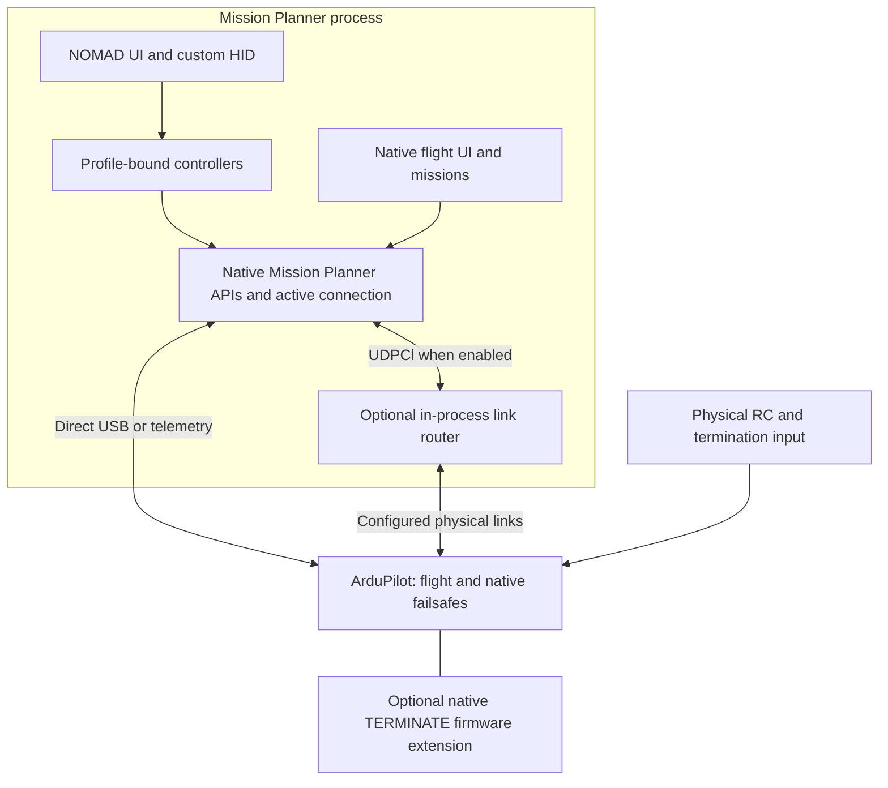

# Architecture

NOMAD runs inside Mission Planner as one C#/.NET Framework 4.8 plugin.
The reviewed host version is stored in `scripts/release/mission-planner-target.json`.



Mission Planner owns opening/closing the selected aircraft connection, its protocol
reader, ordinary flight UI, firmware setup and mission execution requests. ArduPilot
owns stabilization, navigation execution and native failsafes. NOMAD never starts
Mission Planner's HID RC override loop merely to read custom input devices.

`NOMADPlugin` owns the host lifecycle and registers the menus/screens. `Config/`,
`Control/`, `Input/`, `Media/`, `Vision/` and `Views/` are logical source groups compiled into
that same DLL, not separately running services. The C# router sources under
`infra/transport/ground_router/` are also compiled into the plugin. `OutputController`
is the internal guard for dispatch through the current host target.
The separate GPL source carrier under `firmware/ardupilot/` builds aircraft firmware;
its flight policy runs on the Cube, independently of the ground plugin.

## Custom controls

`OutputController` captures the live host connection, stream, system/component IDs
and profile generation. Connection/selection/profile changes retire unsent input.
Closed, read-only and playback contexts cannot dispatch custom commands. A real
centered sample is required after analog input loss or generation changes; held
buttons/keyboard repeats cannot carry activation into another aircraft.

Gimbal uses the host's explicit-target mount APIs and displays submitted/unverified
outcomes. Payload definitions remain in profiles: servo toggle, position and
bidirectional motion, relay toggle and pulse. `PayloadController` owns only local
confirmation/neutral interlocks, input lifetime and software outcome presentation.
Mission Planner owns native ACK waits and retries. Already-dispatched helpers cannot
be cancelled by NOMAD; Safe/Stop waits for the pending helper before attempting Safe.
Native repeat commands bound timed outputs on the controller and have a shared slot.
See [safety](safety.md) for trim checks, uncertain outcomes and unload limitations.

## Links and lifetime

The optional `MAVLinkConnectionManager` owns the existing C# router engine and its
physical UDP/TCP/COM links. It exposes exactly one bidirectional loopback consumer:
Mission Planner, connected using UDPCl. The router forwards each command to one selected link, retains
parameter-transaction pinning, deduplication and failover, and disposes old workers
and sockets before replacement. Unchanged link settings do not restart links.
Profile/physical-link changes require the live MP connection to be disconnected.

Plugin unload closes input/windows, invalidates control ownership and disposes the
router/video workers. Existing menu callbacks are fenced by the plugin session.
No background NOMAD command owner survives unload, although an already-dispatched
host helper or onboard repeat can finish under native host/controller behavior.

## Profiles and presentation

Profiles own optional aircraft notes, calibrated payload/gimbal settings,
HID devices/mappings, physical links and video settings. Draft/copy/import/export
changes stay isolated until explicit Save. Loading validates the current schema
without rewriting operator files. Unknown fields are rejected. Atomic replacement keeps a backup on
explicit Save. Native host state and physical aircraft identity require observation;
a saved label does not establish either.
Ordinary RC arming and flight-mode configuration belongs to Mission Planner and
ArduPilot. NOMAD has no corresponding channel settings or automatic discovery.

Video uses Mission Planner's installed GStreamer support. Optional detection runs
on the existing decoder worker. One owning frame envelope carries its image,
immutable detections, sequence and local receipt timestamps through the latest-frame
slot into the player. HUD and Dashboard playback do not run inference.

`IVideoDetector` is the model boundary. Its YOLOX adapter owns preprocessing,
ONNX Runtime inference and class-aware suppression. `IVisualTracker` independently
owns visual region tracking. Object mode combines CSRT with a frozen appearance
check; Area mode matches an immutable planar reference with ORB and robust homography.
Neither requires detector matches. The video player owns explicit
selection, tracking lifetime and presentation, and sends through the existing
`GimbalController`/`OutputController` native path. There is no separate vision
service or aircraft-control transport. Different YOLOX weights and labels use a
validated JSON profile; a different model architecture implements the same detector
interface without changing tracking or native dispatch. The groundstation's named
model catalog stores strict profile files and references weights in place. One pending selection owns
a clone of the displayed image. The decode worker alone initializes, updates and
disposes the tracker, and publishes its region with the matching current frame.
Source/selection revisions reject superseded results; a shared gimbal claim prevents
embedded and popped-out Video pages from controlling the mount simultaneously.

The DLL embeds pinned CPU runtime binaries, model and notices. Detection lazily
extracts verified assets into the host's user-data vision cache. One asynchronous
constructor loads the latest requested model while decoding continues. Inference
and its matching pixels remain on the decode worker. Revision tags prevent old
model results from reaching overlays, selection or observations. Model loading and
inference support cancellation; detector failure leaves plain video and region
tracking available. CSRT calls have no native cancellation API: input is bounded
to a 640-pixel longest edge, command eligibility retires immediately, and late
results are discarded before worker shutdown.
Tracking requires calibrated limits/FOV, latest-frame buffering and fresh selected
aircraft telemetry. Identity-bound fresh ATTITUDE yaw supplies wrapped body-rotation
compensation inside the same calibrated rate limit; image feedback handles residual
error. The heading reference advances only on submission. Manual input and session changes invalidate pending requests;
uncertain submissions disarm tracking. Area memory survives visual uncertainty,
Stop and manual input; native/source/profile replacement clears it. Searching and
Outside results never authorize commands. Three independent verified matches can
resume an active intent after a visual pause, with a fresh heading baseline and
zero accumulated yaw remainder. Stop/manual/stale input requires explicit rearming.
An already-dispatched native helper may finish.
Observations pair the displayed image with its detections and separately labeled
aircraft position and last submitted tracking request. They do not infer target location.

### Motion estimates and reference lifetime

`VideoMotionHistory` reads the selected Mission Planner packet cache; it opens no
transport and requests no telemetry. Immutable snapshots travel with their decoded
frame and retain connection/stream/aircraft/profile validity. Heading remains
independent of GPS availability. Primary mount selection follows the aircraft's
mount configuration. Reported yaw obeys explicit MAVLink reference-frame flags;
reported or commanded poses are labeled as estimates, not physical measurements.

The bounded history retains original attitude/position receipt times and successful
mount submissions. Camera-delay queries need genuine bracketing samples; heading
wraps through north and submitted target steps are not interpolated into invented
motor motion. A cached HOME is reference state checked against fresh altitude data;
binding, reboot and HOME changes invalidate the corresponding ground estimate.

Optional ground prediction intersects a calibrated camera ray with an explicitly
declared horizontal plane relative to HOME. Current GPS/altitude reprojects the
estimate into a coarse search region. Its local tangent model rejects near-pole
coordinates, rays within five degrees of the horizon and ranges beyond 5 km.
History supports 0–2000 ms declared delay, 128 samples and a three-second window;
missing or stale data disables the hint while visual tracking remains available.

A prior only changes search order. Failed local matching falls back globally in
the same frame, retaining the independent second-placement ambiguity check. A
contradictory unique visual result disables that ground prior for the selection;
the anchor is not moved to manufacture agreement. Plane assumptions and unmeasured
camera pose prevent the estimate from establishing a measured target coordinate or
authorizing unseen-target steering. The heading marker is likewise a display aid.

### Tracking motion compensation

The image supplies a camera ray from the canonical selected point and calibrated
focal length. Rotating that ray by the requested camera pitch gives pitch and
azimuth error; a horizontal pixel offset is not the same as yaw at a downward
camera pitch. Image correction uses a conservative gain of 1/s.

Between fresh `ATTITUDE` messages, heading is predicted from body gyro rates:

```text
headingRate = (sin(roll) * pitchRate + cos(roll) * yawRate) / cos(pitch)
headingNow = wrap(heading + headingRate * packetAge)
yawStep = clamp(imageYawError * dt - aircraftHeadingChange, -rate * dt, rate * dt)
```

The implementation avoids extrapolation near the pitch singularity, rejects
invalid or half-second-old attitude and caps `dt` at 0.2 s. It wraps heading
differences across north and retains rate-clipped compensation until a later
submission; hitting a travel limit clears that remainder. Pitch and combined yaw
steps share the configured per-axis rate bound and absolute travel limits.
No second aircraft-rotation correction is added through reported mount pose.

Decoder receipt time does not identify exposure time. Combining a delayed image
with the latest gimbal orientation would mix different camera poses; increasing
gain does not resolve that timing error. The native mount backend may also report
requested or cached angles rather than fresh measurements. See
[mount integration](integrations.md#aircraft-mounts-and-mavlink) for the native
targeting boundary and CADDX behavior.

Fence setup validates one
inclusion polygon and selects Fence in the native Plan editor. A plugin-owned session
preserves unsaved Mission/Fence/Rally rows across mode changes without changing aircraft
caches. Staging never uploads; native Write/Read owns fence transfer. The page separately
reads supported fence-response parameters and applies confirmed changes through captured
native MP parameter requests, requiring a fresh disarmed heartbeat and value readback.
An optional controlled-termination subgroup shares the plugin's native capability
discovery and confines AFS writes to controlled action 44, its rate bounded by a fresh
native descent limit, and supported RC/fence triggers. It never changes ordinary
LAND/QLAND rates or selects a dedicated RC channel.
NOMAD does not evaluate local outline crossings or claim containment. Unsaved coordinate
text/order and inactive editor drafts remain in memory for the plugin session; save
needed drafts before unloading the plugin. Alerts and visual tracking do not command
aircraft movement. The optional [native termination](native-termination.md) entry uses the
same captured host target and an advertised aircraft mode; policy/execution remain
onboard. Competition server, autonomous target pursuit and takeover integrations remain outside
this implementation; requirements remain in [PRD](prd.md).

See [video and tracking](video.md) for calibration and operator workflow, and
[ecosystem integration](integrations.md) for aircraft mounts and companion services.
