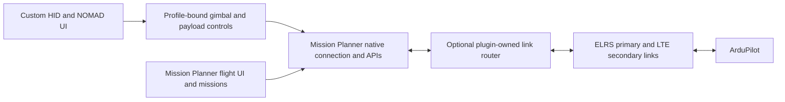

# Architecture

NOMAD runs inside Mission Planner as one C#/.NET Framework 4.8 plugin.
The reviewed host version is stored in `scripts/release/mission-planner-target.json`.
The former C++ runtime, independent CLI, authenticated IPC and MAVSDK command owner
are archived on `MAVSDK-Archive` and are not active product components.

Mission Planner owns opening/closing the selected aircraft connection, its protocol
reader, ordinary flight UI, firmware setup and mission execution requests. ArduPilot
owns stabilization, navigation execution and native failsafes. NOMAD never starts
Mission Planner's HID RC override loop merely to read custom input devices.

## Custom controls

`OutputController` captures the live host connection, stream, system/component IDs
and profile generation. Connection/selection/profile changes retire unsent input.
Closed, read-only and playback contexts cannot dispatch custom commands. A real
centered sample is required after analog input loss or generation changes; held
buttons/keyboard repeats cannot carry activation into another aircraft.

Gimbal uses the host's explicit-target mount APIs and displays submitted/unverified
outcomes. Payload definitions remain in profiles: servo toggle, position and
bidirectional motion, relay toggle and pulse. `PayloadController` owns only local
confirmation/neutral interlocks, input lifetime and software outcome presentation.
Mission Planner owns native ACK waits and retries. Already-dispatched helpers cannot
be cancelled by NOMAD; Safe/Stop waits for the pending helper before attempting Safe.
Native repeat commands bound timed outputs on the controller and have a shared slot.
See [safety](safety.md) for trim checks, uncertain outcomes and unload limitations.

## Links and lifetime

The optional `MAVLinkConnectionManager` owns the existing C# router engine and its
physical UDP/TCP/COM links. It exposes exactly one bidirectional loopback consumer:
Mission Planner, connected using UDPCl. No separate router service or backend command
consumer ships. The router forwards each command to one selected link, retains
parameter-transaction pinning, deduplication and failover, and disposes old workers
and sockets before replacement. Unchanged link settings do not restart links.
Profile/physical-link changes require the live MP connection to be disconnected.

Aircraft-side UART fan-out remains a separate deployment concern. The
[serial router template](../infra/transport/mavlink_router/main.conf) and
[systemd template](../infra/systemd/nomad-mavlink-router.service) are retained data;
the ground plugin neither deploys nor replaces that daemon.

Plugin unload closes input/windows, invalidates control ownership and disposes the
router/video workers. Existing menu callbacks are fenced by the plugin session.
No background NOMAD command owner survives unload, although an already-dispatched
host helper or onboard repeat can finish under native host/controller behavior.

## Profiles and presentation

Profiles own optional aircraft notes, calibrated payload/gimbal settings,
HID devices/mappings, physical links and video settings. Draft/copy/import/export
changes stay isolated until explicit Save. Loading strips retired service credentials
in memory and never rewrites operator files. Atomic replacement keeps a backup on
explicit Save. Native host state and physical aircraft identity require observation;
a saved label does not establish either.
Ordinary RC arming and flight-mode configuration belongs to Mission Planner and
ArduPilot. NOMAD has no corresponding channel settings or automatic discovery.

Video uses Mission Planner's installed GStreamer support. Map polygons and received
positions are local advisory display only: they do not upload fences or command a
breach response. Alerts/audio and video do not become flight authority. Competition
server/perception/takeover/termination integrations remain outside the shipped scope;
requirements and unresolved questions remain in [PRD](prd.md).
