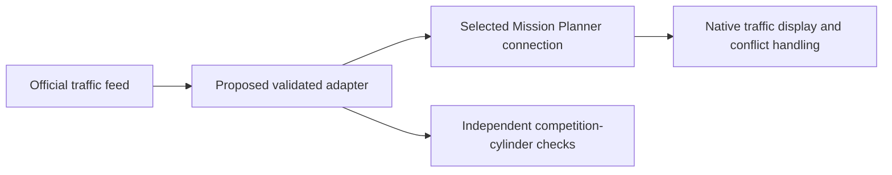

# Brainstorming: approaches to the AEAC tasks

This is the place for proposed task strategies, hardware approaches and research.
Items here are ideas to evaluate, not implemented NOMAD features or aircraft setup
instructions. [Product scope](prd.md) describes current boundaries;
[CONOPS traceability](conops-requirements.md) supplies the actual requirements.
Recheck external sources at a chosen revision before adopting an approach.

## Task 1: survey, counting and tag reading

The recorded aircraft direction is a lightweight VTOL, ground-based CV/compute and
no onboard Jetson for Task 1. A Pi Zero was proposed for backup LTE and possibly
video. Walksnail FPV is planned; the additional camera remains undecided.
These choices need aircraft-specific integration and acceptance.

- Start with reliable operator-reviewed survey evidence. Evaluate deer detection,
  duplicate counting, cluster grouping and tag/anomaly reading independently.
- Use the existing video/model/tracker boundaries for perception experiments.
  The bundled COCO vehicle detector has no deer class. Train/evaluate genuine
  deer/decoy weights and test held-out viewpoints, compression and lighting.
- Measure whether the fixed camera can resolve ear tags at the intended altitude
  and speed. Centering a target cannot recover unreadable image detail.
- Explore a text-export/review workflow once the official submission and clustering
  rules are resolved. Keep images as internal evidence, separate from mandated text.
- Use the existing Medicine Hat world for repeatable trials, then compare with
  real camera data. Its terrain and deer are approximations.

## Task 1: traffic through native infrastructure

Explore converting official aircraft reports to MAVLink `ADSB_VEHICLE` through
the selected Mission Planner connection, reusing native traffic display/conflict
infrastructure. Begin with reporting/advisories and demonstrated operator avoidance.
Automatic avoidance needs a separately reviewed policy and aircraft acceptance.

First resolve [Q04](prd.md#unresolved-organizer-questions): protocol/authentication,
altitude datum, cylinder dimensions, timestamps, velocity/accuracy, boundary equality,
freshness and outage response. Native traffic settings alone do not establish the
competition's per-contact exclusion zones.

A future adapter should reject malformed/out-of-order data, suppress own-aircraft
reports, maintain unique identifiers and preserve reported versus estimated values.
Do not turn missing velocity into zero or refresh an old position as age zero.
Feed-health warnings must remain independent of contact expiry.

Research starting points: [MAVLink packet definition](https://mavlink.io/en/messages/common.html#ADSB_VEHICLE),
[ArduPilot companion-supplied traffic](https://ardupilot.org/plane/docs/common-ads-b-receiver.html#ads-b-traffic-from-a-companion-computer),
and [pinned native ingestion](https://github.com/ArduPilot/ardupilot/blob/fb773567896014da007bca58358704d4a0d8516f/libraries/AP_Avoidance/AP_Avoidance.cpp).

Tim Tuxworth's [Plane DAA proposal](https://github.com/ArduPilot/ardupilot/pull/33955)
is another research lead; its [pinned applet description](https://github.com/timtuxworth/ardupilot/blob/202d00f51476546658029ef1ca60a5b60a468d87/libraries/AP_Scripting/applets/planedaa.md)
concerns scripted fixed-wing avoidance. Do not infer Copter, VTOL hover or transition
coverage. NOMAD's firmware build disables scripting, so an experiment would require
a separately pinned variant. The [PteroSim demonstration](https://youtu.be/dV6-yDYsGgs)
is a scenario reference, not NOMAD qualification evidence.

Evaluate deterministic head-on, crossing, overtaking, altitude-separated and
multiple-contact cases, plus stale/missing/resumed reports. Compare the exact
cylinder oracle with native decisions and observe mission continuation/takeover
before considering commanded avoidance. Preserve native failsafes and termination.

## Task 2: tracker placement and sampling

The recorded direction is a quadcopter strictly below 15 kg all-up, with a Jetson
Orin Nano and an arm for tracker placement and permitted samples. The tracker
(possibly ESP32), mechanisms and physical feedback remain undecided. Here4/RTK is
intended; correction delivery and degraded fixes require acceptance.

- Prototype one supervised physical action at a time with observable feedback.
  Generic servo/relay commands cannot establish attachment, retrieval or sample integrity.
- Check the 100 m moving-target offset against every sampling and return path.
  Evaluate tracker placement and box-placement strategies against actual scoring.
- Define clock alignment and CSV provenance once Q07 is resolved. Keep attempts
  separate and never replay uncertain placement/sample actions after reconnect.
- Treat Task 2 battery swaps and autonomous sample credit as conditional on Q03/Q06.
- Evaluate ground-controller termination input and alternate LTE pilot authority
  separately from payload HID. Define takeover and explicit handback before implementation.

## Other research leads

| Candidate | Question for this project |
|---|---|
| [Project AirSim](https://github.com/iamaisim/ProjectAirSim) | Does it improve rendered-camera coverage beyond the existing Gazebo harness on the target laptop? |
| [Aerial Autonomy Stack](https://github.com/JacopoPan/aerial-autonomy-stack) | Are its sensor/gimbal tools useful for an isolated experiment without adding another product control owner? |
| [last_letter](https://github.com/Georacer/last_letter) | Can measured aircraft mass, inertia and propulsion produce a realistic recipe for the existing headless backend? Stock plus-frame data is not MegaQuadV2 data. |
| [Renode](https://github.com/ArduPilot/ardupilot_wiki/blob/master/dev/source/docs/renode-emulation.rst) | Would board/driver emulation answer a specific firmware fault question that SITL cannot? |
| [mavlink-camera-manager](https://github.com/mavlink/mavlink-camera-manager), [BlueOS](https://github.com/bluerobotics/BlueOS), [Rpanion-server](https://github.com/stephendade/Rpanion-server) | Could a separately configured service supply the required video/telemetry endpoint? No management integration exists in NOMAD. |
| [ArduPilot CADDX setup](https://ardupilot.org/copter/docs/common-caddx-gimbal.html) | Which installed mount generation/backend provides real orientation feedback and verified travel limits? Use native mount control. |

Prefer an experiment with a concrete question, independent success/failure criteria
and existing owners over a new framework. Keep trial plans/results in ignored
`local/`; move an accepted implementation's contract into its owning guide.
