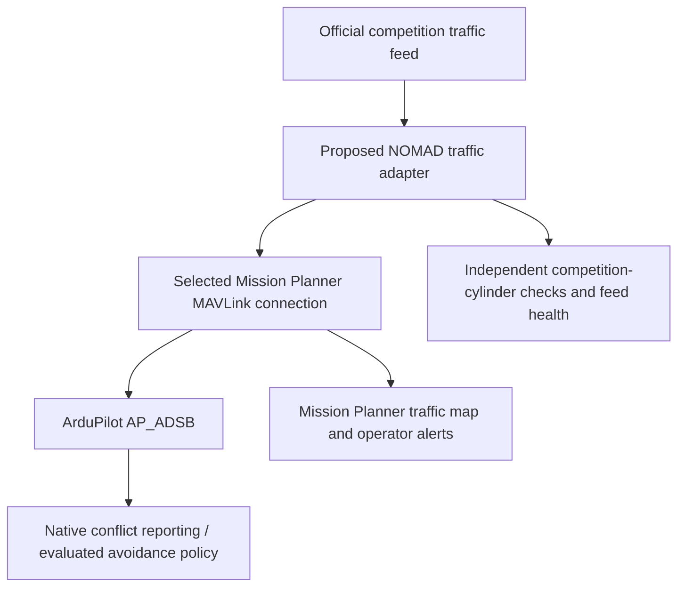

# Brainstorming and future work

Research ideas for NOMAD. These are not implemented features or aircraft configuration
instructions. Sources were checked on **26 October 2026**; upstream branches and
pull requests must be checked again before implementation.

## Task 1 traffic through native ADS-B infrastructure

Explore converting the competition server's aircraft reports into MAVLink
`ADSB_VEHICLE` messages through the selected Mission Planner connection. ArduPilot
can receive traffic from a MAVLink source without a physical ADS-B receiver.
This could reuse native traffic tracking, Mission Planner visualization and
ArduPilot conflict reporting. Automatic avoidance would be a separately qualified
choice. [ArduPilot companion-supplied traffic](https://ardupilot.org/plane/docs/common-ads-b-receiver.html#ads-b-traffic-from-a-companion-computer)

There is currently no competition traffic adapter in NOMAD. The official wire
contract and [Q04 traffic semantics](prd.md#unresolved-organizer-questions) remain
prerequisites. In particular, confirm altitude datum, cylinder radius and vertical
extent, timestamp meaning, available velocity/accuracy and required stale-feed response.

### Adapter responsibilities

- Validate source timestamps and local receipt age, reject malformed/out-of-order
  reports, and suppress the team's own aircraft. Maintain stable unique synthetic
  identifiers without colliding with other traffic.
- Preserve the distinction between reported and estimated velocity. Use a bounded
  history and uncertainty-aware filtering if velocity must be estimated; missing
  velocity must not silently become zero.
- Convert coordinates, altitude, course and velocity into the packet's units and
  references. Set validity flags and `tslc` honestly. UAV emitter category is useful
  only where the selected downstream implementation actually retains it.
- Keep feed-health alerts independent of track disappearance. An expired contact
  is not evidence of clear airspace. Never refresh an old position as age zero.
- Independently evaluate the official moving cylinders, including latency,
  position uncertainty, turning/reaction distance and exact boundary conventions.
  Native separation settings do not establish competition compliance.

The [MAVLink packet](https://mavlink.io/en/messages/common.html#ADSB_VEHICLE) has
identity, position, altitude type, velocities, emitter category, validity and age;
it has no per-contact keepout radius or vertical extent. At NOMAD's pinned
ArduPilot revision, ADS-B traffic and avoidance obstacles age out after roughly
five seconds, and the location conversion does not perform a barometric/geometric
datum transformation from `altitude_type`. Stock avoidance consumes velocity but
does not carry per-contact cylinder dimensions or emitter category into its obstacle
representation. Recheck these details at the chosen firmware revision.
[Pinned ADS-B handling](https://github.com/ArduPilot/ardupilot/blob/fb773567896014da007bca58358704d4a0d8516f/libraries/AP_ADSB/AP_ADSB.cpp#L468),
[timestamp handling](https://github.com/ArduPilot/ardupilot/blob/fb773567896014da007bca58358704d4a0d8516f/libraries/AP_ADSB/AP_ADSB.cpp#L820),
[avoidance ingestion](https://github.com/ArduPilot/ardupilot/blob/fb773567896014da007bca58358704d4a0d8516f/libraries/AP_Avoidance/AP_Avoidance.cpp#L268),
[obstacle age limit](https://github.com/ArduPilot/ardupilot/blob/fb773567896014da007bca58358704d4a0d8516f/libraries/AP_Avoidance/AP_Avoidance.h#L155).

### Tim Tuxworth's scripted Plane DAA proposal

[ArduPilot PR #33955](https://github.com/ArduPilot/ardupilot/pull/33955) was open and
unmerged when checked, at head `202d00f51476546658029ef1ca60a5b60a468d87`.
Its [pinned applet documentation](https://github.com/timtuxworth/ardupilot/blob/202d00f51476546658029ef1ca60a5b60a468d87/libraries/AP_Scripting/applets/planedaa.md)
describes Lua BendyRuler DAA, separation/prediction settings, geofence handling,
the applet plus five support modules, and required native bindings.

Commanded avoidance targets Plane and QuadPlane **fixed-wing flight**. Do not infer
Copter, VTOL hover or transition coverage. The document suppresses ordinary actions
during takeoff, landing and prelaunch, but its nondefault trapped-failsafe has a
separate caveat. Known limitations and mode/navigation recovery require explicit
review; mission completion or waypoint preservation must be observed, not assumed.

Feature inclusion depends on target size: the cited head describes default inclusion
above 2 MB program space and explicit inclusion on ordinary 2 MB boards such as
CubeOrangePlus. NOMAD's [recorded firmware](https://github.com/McGill-Aerial-Design/NOMAD/blob/main/firmware/ardupilot/source.json)
has scripting disabled. Evaluating this applet therefore needs a separate pinned
experimental firmware variant; it is not a parameter-only addition to the current
build. Native termination and its independent RC/fence policy remain separate.

The [PteroSim demonstration](https://youtu.be/dV6-yDYsGgs) is a useful scenario
reference, not proof that a particular NOMAD firmware/test cohort is qualified.

### First evaluation scope

Start with isolated SITL and detection/reporting only. Verify native aircraft symbols
and independent conflict observations before considering avoidance commands. Treat
`ADSB_TYPE`, `AVD_ENABLE`, `AVD_F_ACTION` and the proposal's `DAA_*` settings as
revision-specific configuration to review; no settings are changed by this idea page.

Replay deterministic head-on, crossing, overtaking, diverging, different-altitude,
multiple-contact, delayed, duplicate, missing and resumed reports. Compare the exact
competition-cylinder oracle with native conflict decisions. Observe actual mode,
mission sequence, waypoint completion and operator takeover across all intended
flight phases. Preserve native failsafes and NOMAD's RC-loss/GCS-loss distinction.
Traffic integration, DAA porting and any native avoidance-policy modification are
separate work from gimbal simulation testing.

## Simulation and firmware research leads

| Candidate | Role worth evaluating | Evidence and question |
|---|---|---|
| Project AirSim | Rendered camera and ArduPilot SITL tests | [Current repository](https://github.com/iamaisim/ProjectAirSim), [ArduPilot integration](https://github.com/iamaisim/ProjectAirSim/blob/main/docs/controllers/ardupilot.md). Verify the chosen release, mount/camera path and required vehicle support; do not equate broader platform support with ArduPilot support. |
| Aerial Autonomy Stack | Gazebo/ROS 2 camera, sensor-gimbal and autonomy tooling | [Current repository](https://github.com/JacopoPan/aerial-autonomy-stack). Inspect actual feedback, axes and control routes; the documented pitch topic alone does not establish a complete three-axis tracking loop. Measure the target laptop rather than extrapolating published benchmarks. |
| last_letter | Complementary headless dynamics and SITL testing | [Current repository](https://github.com/Georacer/last_letter), [ArduPilot bridge](https://github.com/Georacer/last_letter/tree/master/frontends/ardupilot). Its current README includes Plane and Copter recipes plus a linear copter research model; establish a separate source of rendered pixels for vision tests. |
| Renode | Board/driver/ChibiOS firmware emulation | [Merged PR #33975](https://github.com/ArduPilot/ardupilot/pull/33975), [current guide](https://github.com/ArduPilot/ardupilot_wiki/blob/master/dev/source/docs/renode-emulation.rst). Board emulation is a different test layer from rendered camera scenes. |

Use current source and reproducible version pins. In particular, the current
last_letter README supersedes assumptions based on older fixed-wing/ROS-era pages.
The linearized recipe is a control-research model, not evidence of nonlinear flight,
transition or image-rendering fidelity.
