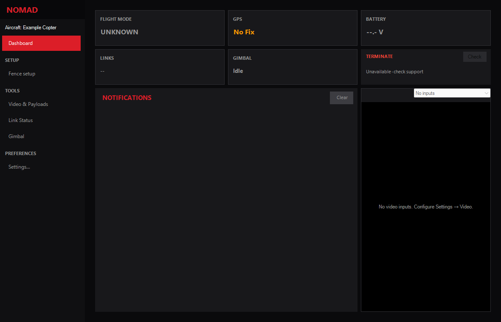

# NOMAD for Mission Planner

NOMAD adds aircraft profiles, video, custom gimbal/payload/HID controls, native
fence setup and redundant telemetry routing to Mission Planner on Windows.
Mission Planner owns normal aircraft operation; ArduPilot owns flight and failsafes.

## Get started

Install the reviewed **Mission Planner 1.3.83** host and follow
[installation and operation](operations.md). Select an aircraft profile, review
its calibration and mappings, then Save. Connect using Mission Planner and verify
the live aircraft before using custom controls.

| Guide | Use it for |
|---|---|
| [Operations](operations.md) | Installation, profiles, links, fences, gimbal, payloads and HID |
| [Video and tracking](video.md) | Camera inputs, calibration, Object/Area tracking, models and observations |
| [Architecture](architecture.md) | Source ownership, Mission Planner telemetry/commands and reusable helpers |
| [Development](development.md) | Build prerequisites, executable checks and simulator entry points |
| [Safety and qualification](safety.md) | Interlocks, software evidence and aircraft acceptance |
| [Native termination](native-termination.md) | Optional firmware, commissioning, operation and release procedure |
| [Product scope and AEAC tasks](prd.md) | Workflows and unresolved organizer questions |
| [CONOPS traceability](conops-requirements.md) | Versioned source requirements and required evidence |
| [Brainstorming](brainstorming.md) | Proposed approaches to AEAC tasks and research leads |

Source builds start with [development](development.md#build-without-installation).
Build/test never installs the plugin. Tracking moves the gimbal; it does not
navigate the aircraft or operate payloads.

For a reproducible issue, include NOMAD source/version, Mission Planner version,
vehicle/firmware, expected behavior and a small reproduction. Remove private URLs,
credentials, identifiers and location data from shared profiles or logs.
