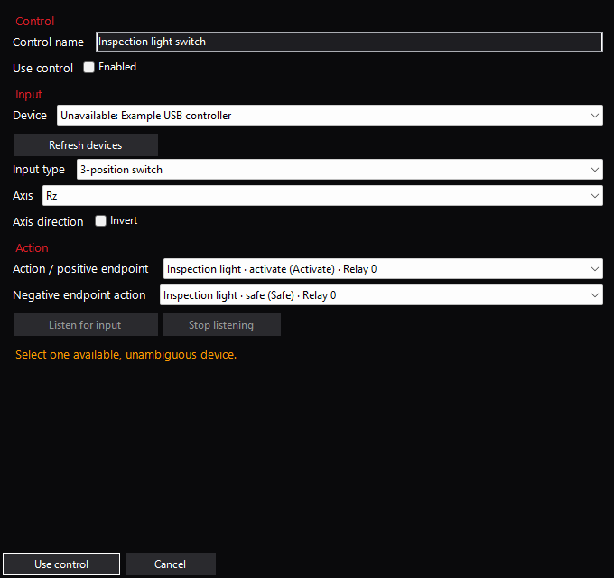

# Operations

Use the reviewed Mission Planner version in
[`mission-planner-target.json`](https://github.com/McGill-Aerial-Design/NOMAD/blob/main/scripts/release/mission-planner-target.json).
Builds/tests do not install software, change operator settings or control aircraft.

## Plugin installation

Download the matching **NOMAD-version-Setup.exe** from the published plugin release.
It is a single offline Windows/.NET Framework 4.8 executable. Mission Planner must already be
installed at the reviewed version; setup does not install the host or its dependencies.

1. Close Mission Planner from the installation you want to update.
2. Run setup and approve the Windows administrator prompt.
3. Confirm the detected Mission Planner folder, or use **Browse** to select a portable installation.
4. Select **Install**, then open Mission Planner normally and review the selected aircraft profile.

Setup validates the bundled DLL and target host, backs up an existing DLL under
`Mission Planner/NOMAD-backups/`, replaces only `plugins/NOMADPlugin.dll` and clears its download marker.
It does not launch Mission Planner, change profiles or configure aircraft. A failure displays its backup
location and whether replacement may have occurred. For rollback, close Mission Planner and restore
the saved DLL; unblock it if it carries an Internet download marker.

The setup executable is currently unsigned; Windows can display an unknown-publisher or SmartScreen
warning. Verify its published checksum and source before running it.

### Manual plugin installation

1. Build and review `mission_planner/src/bin/Release/NOMADPlugin.dll` using
   [development checks](development.md). Record the checked source and test results.
2. Close Mission Planner. Preserve the existing plugin DLL and real operator profiles
   outside the replacement destination before any manual change.
3. Explicitly copy only the reviewed `NOMADPlugin.dll` into the `plugins` directory
   of the intended Mission Planner installation. For a trusted downloaded DLL, use
   **Properties → Unblock → Apply**, or `Unblock-File -LiteralPath <DLL-path>`, before starting the host.
4. Verify the host version, plugin version/source identity and selected aircraft
   profile. Review mappings and calibration before enabling custom controls.

Host reference assemblies, binaries and installed dependencies are not copied into
NOMAD artifacts. Video requires the host's installed GStreamer support. Keep the
previous reviewed DLL available for manual restoration with Mission Planner closed.

## Saved aircraft profiles

By default, NOMAD stores profiles in
`%LOCALAPPDATA%/Mission Planner/plugins/nomad_aircraft_profiles.json` and its rolling
diagnostic log in `plugins/NOMAD/nomad.log` under that same Mission Planner root.
When the host explicitly sets an absolute custom user-data directory before
loading NOMAD, both profiles and logging use `plugins/` under Mission Planner's
resolved user-data directory, including its application-name subdirectory.
An invalid explicit root is rejected; it never falls back to operator storage.
Only the current profile collection schema is accepted. Unknown or invalid fields
are rejected; loading never converts or rewrites the file. If the primary file is
absent, its current-format `.bak` can be loaded. With neither file present, NOMAD
starts with a fresh profile.
To start fresh after a validation error, close Mission Planner and move both the
named file and its `.bak` to a private backup folder, then reopen the host. Setup
preserves these files; it does not convert or repair invalid profiles.
Explicit Save replaces atomically with a `.bak`; cancelled/failed saves preserve the
previous saved collection. Keep profiles private: connection URLs can contain sensitive
details even though runtime credentials are no longer stored/exported.

Each profile owns optional aircraft notes, gimbal mode/rate, calibrated payload
outputs, HID mappings, links and video. Aircraft notes are operator labels, not live
readbacks. Configure ordinary RC arming and flight modes through Mission Planner and
ArduPilot. New profiles start without inherited payload mappings. Copy/import/export
use the current schema and remain drafts until Save.
Open settings from the NOMAD menu or sidebar. The persistent Editing label identifies
the draft aircraft; Save activates it. Profile actions contains reset, load and export.
Links, Video, Payloads and Inputs belong to that draft; Preferences contains alerts
and startup diagnostics.
Payloads, Links and Inputs provide a list with Add, Edit and Remove. Their dialogs validate
the complete draft before accepting changes; Cancel leaves it untouched. Friendly
name changes preserve stable IDs and saved input bindings. Payload dialogs show
calibration, bounded timings and confirmation/neutral interlocks for the selected
behavior. Link dialogs distinguish UDP local listening ports from TCP remote server
ports; COM devices are entered explicitly and are never scanned or opened by setup.
Inputs adds named controls bound to an explicit input device. Choose a button,
paired buttons, a continuous axis, or a two/three-position axis switch, then select
payload actions. Continuous axes also support gimbal pitch/roll movement; digital
gimbal controls are not offered. Actions show payload names and retain stable IDs.
Unavailable saved bindings remain visible for correction. Continuous position only
lists nonhazardous position payloads without confirmation requirements.

Disconnect the aircraft before Listen, select one device, then move a button,
toggle or axis. Listen detects both button edges and axis movement. For an axis,
choose continuous or two/three-position interpretation; for paired buttons, listen
for each endpoint. Listen stops on timeout, device loss, cancellation or connection
opening. It sends no commands and does not change Mission Planner's native joystick
settings. Opening Settings pauses NOMAD HID and arrow inputs and waits for admitted
Safe work; Cancel restores the same live profile with fresh neutral/center required.

A two-position axis switch uses one endpoint as inactive neutral and the other as
its action; Invert swaps them. Returning inactive does not turn a latched payload
off. Bind Safe explicitly where needed. Three-position switches require a sampled
center between opposite endpoints. Simultaneous opposing buttons request Safe for
both mapped payloads. Button labels start at 1; saved/host indices start at 0.
`Inputs` is the current configuration schema; there is no legacy input conversion.

Use Mission Planner for connection, arm/disarm, flight modes, takeoff, LAND, setup
and missions. Disconnect Mission Planner before applying a different aircraft profile
or changed physical routes. Saving unrelated settings does not restart those routes.
Reconnect explicitly and verify the live aircraft before using custom controls.

## Native fence setup

In NOMAD → Fence Setup, paste one coordinate pair per line and choose the coordinate
order. Open Plan and Stage select native Fence automatically; unsaved Mission, Fence
and Rally editor rows are preserved across mode changes during this plugin session.
Stage asks before replacing the Fence draft. Review it in native Plan, use native Write,
then native Read to verify the aircraft fence. Save needed drafts before plugin unload.

Under Aircraft fence response, Read aircraft settings shows the selected aircraft's
supported `FENCE_*` parameters with native firmware metadata. Missing metadata is
read-only. Apply lists changes and the captured aircraft/system/component, defaults to
Cancel, requires a fresh disarmed heartbeat and verifies each write by a separate read.
Writes are sequential: a failure stops remaining changes, earlier writes remain and
the page requires a new Read before retrying. Review actual fence responses before flight;
parameter readback does not qualify containment or touchdown. Controlled termination
shows supported extension settings only after native capability discovery: separate
descent speed, controlled response 44 and AFS RC/fence triggers. See the
[commissioning requirements](native-termination.md#aircraft-setup); channel assignment
and other aircraft failsafes remain in Mission Planner's setup pages.

NOMAD does not modify normal LAND or QLAND settings. The optional
[native termination](native-termination.md) extension provides a separate onboard
mode and a guarded Dashboard action. It requires the matching custom firmware
and actual aircraft commissioning; fence draft staging provides neither.

Click the top NOMAD item to open its page. While already there, left-click opens
the dropdown without resetting the current view; right-click opens that dropdown
from any page. The dropdown contains settings/tools, not the termination action.

## Video and tracking

Add named camera inputs in **Settings → Video**, then choose the active input on
Dashboard or Video. The [video guide](video.md) covers receiver buffering, selection,
gimbal calibration, local detection, observations and replacement model profiles.

## ELRS and LTE links

Enable the profile's plugin router only when needed. Configure its physical links
and preferred link ID in the Links settings, using the reviewed ELRS primary
and LTE secondary topology. An empty link list opens no physical connection.
Connect Mission Planner with UDPCl to `127.0.0.1` and the profile's local router port.
The plugin owns sockets/serial handles and closes them on profile replacement/unload.
Aircraft-side telemetry endpoints and video/network services are commissioned separately.

## Gimbal, payload and input

Select explicit HID devices; missing or ambiguously named devices are never substituted.
After reconnect/input loss, center analog controls and release buttons before fresh
activation. Payload hazardous actions require their configured distinct confirmations
and neutral edges. Safe/Stop remains explicit. Review the chosen channel, PWM bounds,
neutral/safe values and actual aircraft wiring before use.

Timed servo actions read live captured-target `SERVOx_TRIM` and require it to match
the configured return value. Native repeats share one controller slot; the UI reports
busy/uncertain state. Mission Planner may retry commands and complete a dispatched
helper after Stop is requested. A Safe ACK is software evidence, not measured motion.
Unknown outcomes block activation replay until explicit accepted Safe. Do not assume
external MP/mission commands preserve NOMAD's repeat reservation or commanded state.

Use Safe/Stop and wait for the native result before disconnecting or closing MP.
Unload attempts best-effort Safe; it cannot guarantee return delivery, cancel a native
helper already executing, or prove physical de-energization. Onboard repeats retain
native controller return behavior. Keep physical emergency procedures and ArduPilot
failsafes independently qualified. Stock LAND/disarm is not a substitute for the
separate [native termination](native-termination.md) mechanism or aircraft acceptance.
