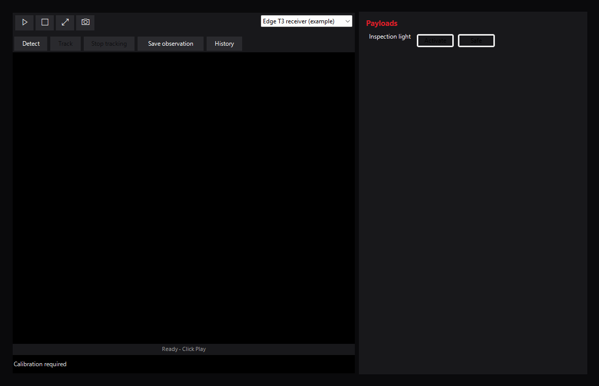

# Video and tracking

Watch live video, select a region and follow it with a calibrated gimbal.
Detection and tracking run locally in Mission Planner; ordinary aircraft flight
controls remain in Mission Planner.

## Video inputs

Settings → Video stores named inputs for the selected aircraft. Add an input, enter
its name and source URL, then Save the definitions. Browsing or editing an input in
Settings does not change playback. Choose the active input from the top-right of
the Dashboard preview or Video player; that choice is saved for the aircraft and
updates HUD video and both NOMAD views. A stopped player stays stopped.
Renaming the active definition preserves its selection; removing it chooses the
first remaining input. Remove the final input to leave video unconfigured. Profiles use
`VideoInputs` and `SelectedVideoInputName`; imports must use that same current schema.

RTSP negotiates the video codec supported by the installed GStreamer decoder. Select
TCP or UDP transport and a 0..5000 ms jitter buffer. UDP source URLs such as
`udp://@:5600` listen for RTP/H.264 on the explicit port; RTSP settings do not affect
those inputs. Camera and MediaMTX URLs, including addresses reachable through
Tailscale, are ordinary operator inputs; NOMAD does not set up their server or network.

The decoded-frame queue holds 1..120 frames. Drop old frames discards old queue
frames and bounds RTSP jitter buffering; disabling it lets the decode queue apply
backpressure. The display and native appsink still keep only the latest frame, so
this is not lossless recording. These receiver settings do not set end-to-end delay,
bitrate, resolution or encoded quality; configure those at the camera or encoder.
URLs can contain credentials: review profile exports before sharing them.

## Vision and gimbal tracking

On the Video page, click an object or textured area, or drag a rectangle around it.
A click selects a small region; dragging gives precise control over its size.
The visual tracker follows that region in the image. Select **Track** to center it
using the gimbal. **Detect** optionally highlights recognized objects and helps
choose their initial bounds. Detection and selection alone send no commands.
**Stop tracking** or a manual NOMAD gimbal input releases
tracking; select an object again to resume. **History** shows the latest 32 transitions.
The same overlays and click/drag selection work in full screen. Tracking requires
Windows x64. Hiding the Video page releases its gimbal control; starting tracking
in another NOMAD window replaces the previous window's control.

Configure each input in **Settings → Video** before enabling tracking:

- Confirm a rectilinear camera with fixed zoom and square pixels, and enter its
  horizontal field of view. Vertical geometry follows the image aspect ratio.
- Enter pitch/yaw limits and image correction directions for the actual mount, then the maximum
  requested-angle rate, from 1 to 60 degrees per second. Yaw calibration can use
  -180 to +180 degrees; enter the mount's actual smaller travel where applicable.
  New inputs start at -90 to +90 degrees. Verify the calibration
  before selecting its confirmation checkbox.
- Enable **Drop old frames** with a **one-frame decode queue**. Start from a manual
  target within the calibrated limits.

Tracking uses pitch and yaw with roll zero. It commands the selected Mission Planner
aircraft's mount, without changing flight mode, navigating the aircraft or operating
payloads. Fresh aircraft attitude and angular rates counter body yaw between
telemetry updates while image feedback corrects
the remaining error. Tracking releases if selected-aircraft attitude is absent,
invalid or more than half a second old. The mount's calibrated speed must leave
margin for aircraft yaw, and its travel limits still apply.
Use the autopilot's supported mount driver for the hardware; NOMAD does not require
a brand-specific desktop driver. The [GM3 setup notes](integrations.md#caddx-gm3)
distinguish internal stabilization from angle feedback available to the plugin.
A tracker-reported loss, stale decoded imagery, stale aircraft
telemetry, an uncertain request, or changing source/aircraft retires tracking.
An already-dispatched native request may finish. Local frame age measures when
NOMAD received decoded pixels; it cannot establish camera capture time or detect
every frozen upstream feed. Similar textures, occlusion and large appearance changes
can cause drift; monitor the selected region. Mechanical response and total video
delay need calibration. Stop revokes further requests immediately; an in-progress
native CSRT update finishes before its worker closes.

**Save observation** writes a PNG and matching JSON under the host user-data plugin
directory's `NOMAD/observations` folder. The JSON includes the input name, model,
frame time, optional detections and scores, the tracked region, recent transitions and separately
labeled aircraft GPS and last submitted tracking request. Target coordinates and
observed gimbal orientation are unavailable. Stream URLs are omitted. Save succeeds
only with a fresh displayed frame and both files written.

### Replace the detection model

An empty **Model profile** uses bundled YOLOX Nano with COCO vehicle classes
(bicycle, car, motorcycle, bus and truck). Inference runs locally on the CPU with
two threads. The model and ONNX Runtime are included in the DLL; detection needs
neither a companion computer nor a network download. General-purpose CSRT tracking
is independent of that model and works on regions that the detector does not recognize.

Start from the [YOLOX profile example](https://github.com/McGill-Aerial-Design/NOMAD/blob/main/mission_planner/examples/vision-yolox.json).
Place trusted ONNX weights beside the JSON, update their SHA256, labels and allowed
class indices, then browse to the JSON in the input's settings. Relative weight
paths resolve beside that JSON. The profile declares the exact supported format:
static float NCHW BGR input, values 0..255, top-left letterboxing with padding 114,
and raw YOLOX grid output at strides 8/16/32. Tensor dimensions and hashes are
checked before use. Unsupported exports produce a vision error while ordinary
video remains available. A different model architecture needs a detector adapter;
it does not need changes to selection or gimbal transport.

## Camera and companion systems

NOMAD accepts configured RTSP streams and RTP/H.264 UDP inputs. See
[ecosystem integration](integrations.md) for the roles of ArduPilot mounts,
camera services and companion computers.
