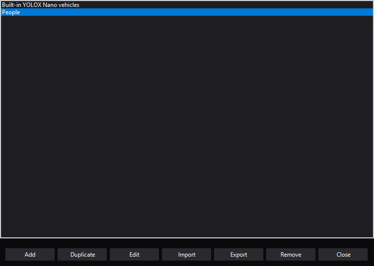
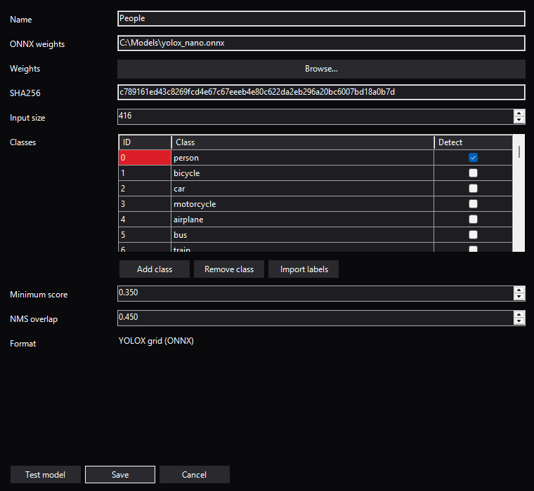

# Video and tracking

Watch live video, select a region and follow it with a calibrated gimbal.
Detection and tracking run locally in Mission Planner; ordinary aircraft flight
controls remain in Mission Planner.

## Video inputs

Settings → Video stores named inputs for the selected aircraft. Add an input, enter
its name and source URL, then Save the definitions. Browsing or editing an input in
Settings does not change playback. Choose the active input from the top-right of
the Dashboard preview or Video player; that choice is saved for the aircraft and
updates HUD video and both NOMAD views. A stopped player stays stopped.
Renaming the active definition preserves its selection; removing it chooses the
first remaining input. Remove the final input to leave video unconfigured. Profiles use
`VideoInputs` and `SelectedVideoInputName`; imports must use that same current schema.

RTSP negotiates the video codec supported by the installed GStreamer decoder. Select
TCP or UDP transport and a 0..5000 ms jitter buffer. UDP source URLs such as
`udp://@:5600` listen for RTP/H.264 on the explicit port; RTSP settings do not affect
those inputs. Camera and MediaMTX URLs, including addresses reachable through
Tailscale, are ordinary operator inputs; NOMAD does not set up their server or network.

The decoded-frame queue holds 1..120 frames. Drop old frames discards old queue
frames and bounds RTSP jitter buffering; disabling it lets the decode queue apply
backpressure. The display and native appsink still keep only the latest frame, so
this is not lossless recording. These receiver settings do not set end-to-end delay,
bitrate, resolution or encoded quality; configure those at the camera or encoder.
URLs can contain credentials: review profile exports before sharing them.

## Vision and gimbal tracking

Choose **Object** or **Area** on Video, then click a target or drag a selection.
**Detect** can propose recognized objects; it is optional. Select **Start tracking** when the
selection is verified to center it using the gimbal. Detection and selection alone
send no mount commands. The same controls and overlays work in full screen.
The fixed-width tracking button switches between **Start tracking** and **Stop tracking**.

### Object tracking

Object mode follows a moving image region using CSRT. A frozen appearance check
rejects a candidate that no longer resembles the original selection, including a
dissimilar foreground obstruction. Loss stops Object tracking; select the target
again to resume. This is visual similarity, not semantic person identification.
Large deformation, occlusion or appearance changes can require reselection.

### Area tracking and memory

Area mode follows a fixed, approximately planar surface. Include distinctive local
texture and surrounding features when selecting grass, pavement or a wall.
The tracker matches an immutable scene reference and verifies a perspective
transform. It steers toward the transformed original point, not the center of a
changing bounding rectangle.

| State | Behavior |
|---|---|
| Verified | The selected area is uniquely matched; an active tracking session may steer within calibration limits |
| Searching | The original reference is retained; no new steering requests are sent |
| Outside | The reference is retained, with a possible coarse direction hint; no new steering requests are sent |
| Ambiguous | Competing or repetitive matches are rejected; the original reference is retained |

After uncertainty, three successive unique visual matches are required before an
active session resumes. A foreground object does not replace the reference.
**Stop tracking**, manual gimbal input or stale imagery disarms automatic recovery
while retaining Area memory. Select **Start tracking** again after verification.
**Clear** discards the remembered area. Changing source, aircraft or profile clears
its reference. Opening another tracking owner disarms the previous owner.

Indistinguishable repeating tiles, featureless surfaces, moving vegetation,
parallax and large viewpoint changes can leave an area searching. A remembered
selection is not evidence of a currently known position. GPS hints cannot turn an
ambiguous match into a verified one.

### Camera and mount calibration

Configure each input in **Settings → Video** before enabling tracking:

- Use a rectilinear camera with fixed zoom and square pixels. Enter its horizontal
  FOV; vertical geometry follows the image aspect ratio.
- Enter the mount's actual pitch/yaw limits and image correction directions.
  Requested-angle rate is 1–60 degrees/s. Yaw calibration supports -180/+180 degrees;
  new inputs start at -90/+90. Confirm calibration only after checking the hardware.
- Enable **Drop old frames** and a **one-frame decode queue**. Start from a manual
  target inside the calibrated limits.

Tracking commands pitch/yaw with roll zero through the selected Mission Planner
connection. Aircraft attitude and angular rates compensate body yaw; image feedback
corrects the residual. Freshness, selected aircraft, input generation, native command
ownership and calibrated travel/rate remain admission requirements. Resume resets
its heading baseline rather than replaying rotation accumulated during a pause.
An already-dispatched native helper can still finish after Stop.

Use ArduPilot's supported mount driver for the hardware. The
[GM3 guide](integrations.md#caddx-gm3) distinguishes internal stabilization from the
feedback exposed to the plugin. Requested or reported target angles do not establish
physical mount orientation.

### GPS and altitude search prediction

**Ground prediction** is optional and disabled by default. Enable it only for a
horizontal surface whose height relative to aircraft HOME is known. Enter that
height in Settings → Video; zero means the HOME elevation, which is not automatically
the elevation beneath the camera. Leave it off for walls, uneven terrain or unknown
surface elevation. Visual Area tracking works independently.

With fresh selected-aircraft GPS/position, a consistent HOME reference and a settled
NOMAD mount-target estimate, a verified area can establish a flat-ground search
estimate. Later aircraft position and altitude changes reproject that estimate.
The amber diamond is a **search hint**, including at the image edge; it never
establishes visual verification or authorizes steering while the area is unseen.
A unique visual match inconsistent with the estimate disables that prior.

**Camera delay** is an estimated camera/encoder delay of 0–2000 ms, separate from
RTSP jitter buffering. Delayed estimates require actual bracketing telemetry
history. Missing history, stale GPS, a changed HOME/binding, shallow rays or an
unsupported geometric range make the hint unavailable. Aircraft altitude is fused
telemetry; NOMAD does not create a separate barometer estimator or infer metric
scene depth from an uncalibrated camera.

### Aircraft heading marker

The short blue line orbiting the crosshair shows the aircraft's facing
heading relative to the camera view: top is aligned, left/right means the nose is
that side of the camera direction, and bottom means behind. It uses aircraft
attitude, not GPS course over ground.

Reported mount orientation or a successful NOMAD target may provide the camera
heading estimate. Hover over the video for source, estimate classification and
angle details. Unknown or stale aircraft/camera data removes the marker. The marker
works in embedded and full-screen video and does not supply aircraft flight controls.

### Save observations

**Save observation** writes a PNG and matching JSON to `NOMAD/observations` under
the host user-data plugin directory. It records input/model/frame provenance,
current detections, tracking mode/state, verified aim point, retained-reference
state, transitions and separately labeled aircraft GPS and submitted mount requests.
A detector-assisted selection retains the identity of the model that supplied its
original label even after a model switch. Search hints remain estimates; target
coordinates and measured gimbal orientation are not claimed. Stream URLs are omitted.

Local frame age measures decoder receipt, not camera exposure time, and cannot
detect every frozen upstream feed. Mechanical response and total video delay need
camera-specific qualification. Stop revokes future requests; an in-progress native
tracker or host helper may finish under its own lifetime.

### Replace the detection model

The bundled YOLOX Nano model uses COCO vehicle classes by default. Detection runs on
the local CPU with two threads; the weights and runtime are included in the DLL.
Area and Object tracking are independent of the selected detector.

Open **Manage models** on Video, or **Manage** beside Detection model in Settings:

1. **Add** trusted ONNX weights, or **Duplicate** an existing model. Duplicating the
   built-in model references its verified embedded-cache weights without copying them.
2. Give the preset a name. To create a People preset, duplicate the built-in model
   and select **person** in the class table. Built-in vehicle filters stay unchanged.
3. Keep labels in the ONNX output order. **Import labels** reads an ordered text file;
   check the classes to detect. Unchecked labels still belong to the model definition.
4. Set input size, minimum score and NMS overlap. SHA256 is calculated from the selected
   weights. **Test model** checks actual loading and tensor compatibility in the background.
5. **Save** the definition, then select it in Video's model dropdown. Cancel leaves the draft unsaved.

Definitions are shared across aircraft/cameras in `NOMAD/models` under the host's
plugin data directory. Stable JSON files reference weights in place. Import/export
uses the [model profile example](https://github.com/McGill-Aerial-Design/NOMAD/blob/main/mission_planner/examples/vision-yolox.json);
relative weight paths resolve beside an imported JSON. Removal deletes the managed
profile and backup, not weights; references to a removed model become unavailable.
A damaged catalog does not stop plain video or silently replace the selected model.

The Video selector saves the model for the active camera without restarting its
source or discarding an independent selected tracking region. Old boxes disappear
immediately. One constructor runs at a time; only the latest requested model may
publish results. Plain video continues during model loading. Inference remains on
the decode worker with matching pixels/results and can reduce display cadence.
A load/inference failure leaves plain video available; choose a valid model and
press **Detect** to retry. No old model is silently kept under a new model name.

Supported exports are raw YOLOX grid ONNX with static float NCHW BGR input 0–255,
top-left letterboxing, padding 114 and strides 8/16/32. Tensor shapes and hashes
are checked. Other model architectures need an adapter; an arbitrary ONNX file
is not automatically interchangeable.

## Camera and companion systems

NOMAD accepts configured RTSP and RTP/H.264 UDP inputs. See
[ecosystem integration](integrations.md) for ArduPilot mounts, camera services and
companion computers.
