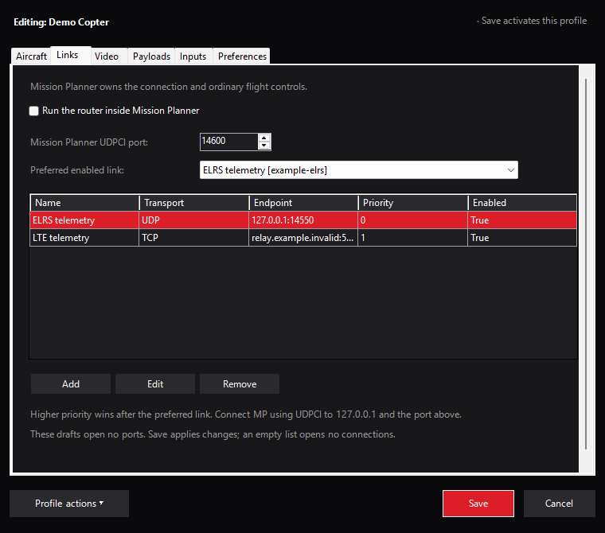

# Plugin-owned ground link router

The NOMAD plugin runs this C# router inside Mission Planner. It combines configured
physical telemetry links into one bidirectional loopback connection for the host.
Physical links and the preferred link are saved per aircraft profile.



*Actual Links settings with synthetic endpoints. The router is stopped; enabled
rows describe the draft configuration, not established connections.*

## Configure a route

1. Disconnect Mission Planner before changing aircraft or route settings.
2. Open **NOMAD → Settings → Links**. Add the reviewed UDP, TCP or serial physical
   links and select the preferred enabled link. The dialogs distinguish local UDP
   listening ports, remote TCP server ports and explicit COM devices.
3. Enable **Run the router inside Mission Planner**, review the local UDPCl port,
   then Save. An empty physical-link list opens no connections.
4. Connect Mission Planner using **UDPCl**, host `127.0.0.1`, and that profile's
   `RouterLocalPort`. The plugin creates one bidirectional consumer named
   `mission_planner`.
5. Verify the live aircraft and inspect **Link Status** before using controls.

A UDP link without an inbound peer needs explicit `RemoteHost` and `RemotePort`
to deliver outbound data. TCP and COM require explicit endpoints. Never point a
physical link back at the router's own loopback consumer.

## Routing behavior

The engine retains UDP/TCP/serial transport, MAVLink frame parsing, link health,
active-link failover/recovery, duplicate suppression and parameter-transaction pinning.
Commands leave on one selected link. A failed send is reported without engine-level
frame retry; MP owns higher-level command retries. Link liveness is based on received
traffic and does not prove command authority or physical aircraft outcomes.

The manager disposes old sockets/workers before replacing routing settings.
Unchanged settings keep physical links running. Profile changes require an explicit
host reconnection and live-aircraft verification.

## Validate changes

From the repository root, after building the plugin:

```powershell
pixi run test-ground-router-logic
pixi run test-plugin-router-ui
```

The logic gate compiles the engine and plugin owner and exercises real loopback
sockets: frame splits/batching, dedup, failover, parameter pinning,
ownership replacement, UTC jumps, reconnect and bounded load. These tests do not
qualify ELRS/LTE RF links, physical takeover or aircraft failsafes.

See [architecture](../../../docs/architecture.md) and
[operations](../../../docs/operations.md) for current product ownership.
