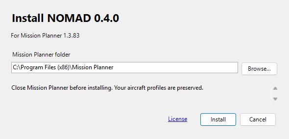

# Mission Planner plugin distribution

NOMAD provides a single offline Windows **Setup.exe** that installs **NOMADPlugin.dll**
into the reviewed Mission Planner host. A standalone DLL and ZIP remain available for manual installation.



## Build the artifact

From the repository root:

```powershell
pixi run build-plugin-only
pixi run build-installer
pixi run test-plugin-installer
```

The build script is [build_plugin_windows.ps1](../../scripts/build/build_plugin_windows.ps1).
It builds Release against the host in
[mission-planner-target.json](../../scripts/release/mission-planner-target.json), embeds
the source/version identity, and writes `mission_planner/src/bin/Release/NOMADPlugin.dll`.
It never copies files into an installed Mission Planner instance. The installer build embeds that DLL,
its expected hash and the applicable notices in `build/installer/NOMAD-version-Setup.exe`.
`installer-manifest.json` records source and payload identities; `SHA256SUMS` covers the setup artifact.

| Include | Keep outside the plugin package |
|---|---|
| Reviewed `NOMADPlugin.dll` | Mission Planner executables and host reference assemblies |
| Source/version identity and validation results | Operator profiles, private endpoints and logs |
| Applicable license notices | Compiled test harnesses and debug-only tools |

Direct development builds can carry a development identity. Record uncommitted
source changes and the DLL checksum with local test results; a base commit alone
does not identify a modified build.

## Install and replace

Run the matching setup from the plugin release, approve the Windows administrator prompt,
confirm the Mission Planner folder and select **Install**. Setup requires that selected host to be closed,
verifies the embedded DLL, saves the previous copy outside `plugins`, installs atomically and clears
the downloaded-file marker. It preserves profiles and never launches the host or touches aircraft.
See [installation and rollback](../../docs/operations.md#plugin-installation).

GStreamer remains an installed host dependency. Profile storage, imports and
Safe/Stop behavior are described in [operations](../../docs/operations.md).
Keep rollback copies outside the active `plugins` directory and restore them only
with Mission Planner closed.

## Validation and publication

Run the applicable [development gates](../../docs/development.md) before distributing
a build. The [Windows workflow](../../.github/workflows/csharp.yml) uploads a checked
DLL and setup as separate Actions artifacts; its tag trigger does not create a GitHub Release.
Hardware behavior requires separate qualification.

The optional [flight-controller firmware](../../firmware/ardupilot/README.md) is a
separate GPL-licensed component with its own board-specific images and corresponding
source. It is not embedded in this DLL or installed by the plugin build.
