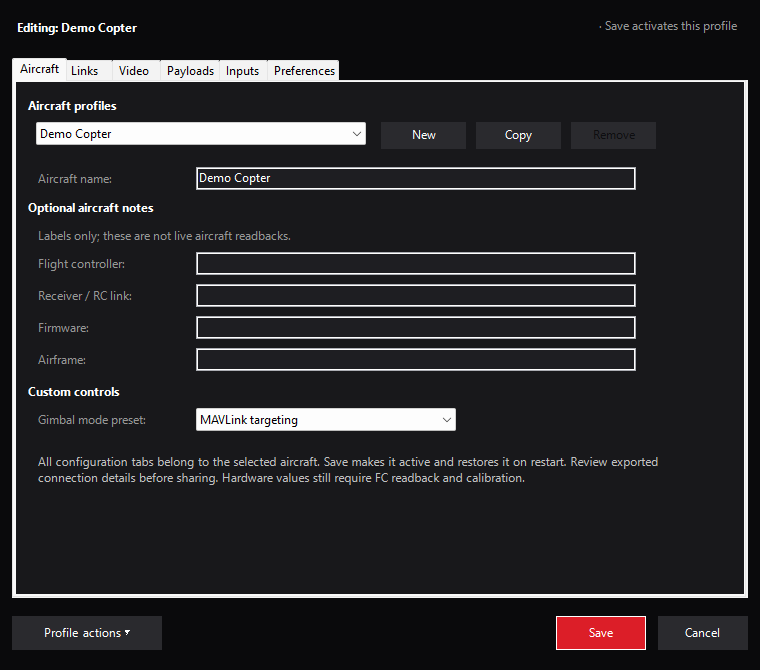

# Mission Planner plugin distribution

NOMAD is distributed as **`NOMADPlugin.dll`**, loaded by the reviewed Mission Planner
host. This directory documents the package boundary; it is not an installer.



*Actual settings controls with an example aircraft profile. Optional aircraft notes
are labels, not flight-controller readbacks. No profile was saved by this capture.*

## Build the artifact

From the repository root:

```powershell
pixi run build-plugin-only
```

The build script is [build_plugin_windows.ps1](../../scripts/build/build_plugin_windows.ps1).
It builds Release against the host in
[mission-planner-target.json](../../scripts/release/mission-planner-target.json), embeds
the source/version identity, and writes `mission_planner/src/bin/Release/NOMADPlugin.dll`.
It never copies files into an installed Mission Planner instance.

| Include | Keep outside the plugin package |
|---|---|
| Reviewed `NOMADPlugin.dll` | Mission Planner executables and host reference assemblies |
| Source/version identity and validation results | Operator profiles, private endpoints and logs |
| Applicable license notices | Compiled test harnesses and debug-only tools |

Direct development builds can carry a development identity. Record uncommitted
source changes and the DLL checksum with local test results; a base commit alone
does not identify a modified build.

## Install and replace

Use the [manual installation procedure](../../docs/operations.md#manual-plugin-installation):
close Mission Planner, preserve the existing DLL and profiles, copy only the
reviewed DLL into that installation's `plugins` directory, then verify the loaded
version and selected aircraft. Do not replace a DLL while the host is running.

GStreamer remains an installed host dependency. Profile storage, imports and
Safe/Stop behavior are described in [operations](../../docs/operations.md).
Keep rollback copies outside the active `plugins` directory and restore them only
with Mission Planner closed.

## Validation and publication

Run the applicable [development gates](../../docs/development.md) before distributing
a build. The [Windows workflow](../../.github/workflows/csharp.yml) uploads a checked
DLL as an Actions artifact; its tag trigger does not create a GitHub Release.
Hardware behavior requires separate qualification.

The optional [flight-controller firmware](../../firmware/ardupilot/README.md) is a
separate GPL-licensed component with its own board-specific images and corresponding
source. It is not embedded in this DLL or installed by the plugin build.
